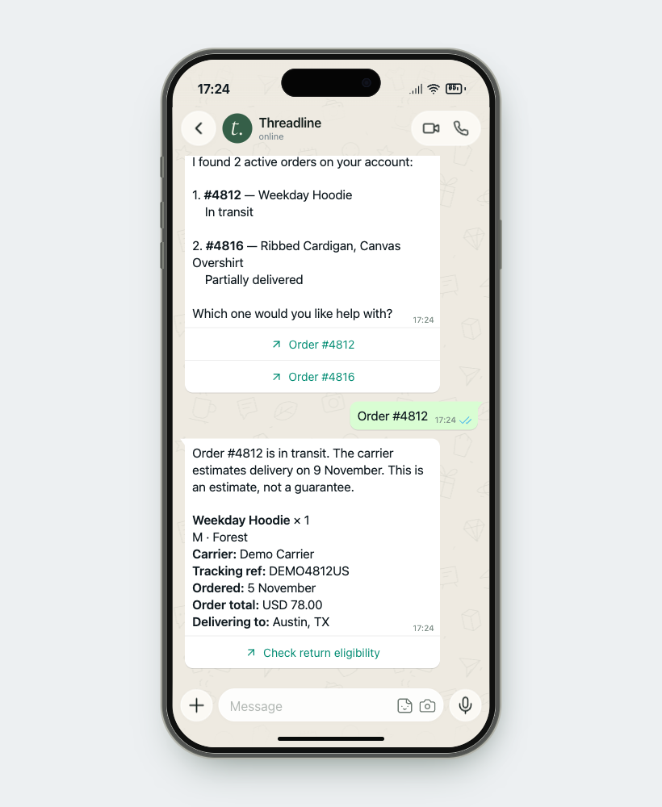
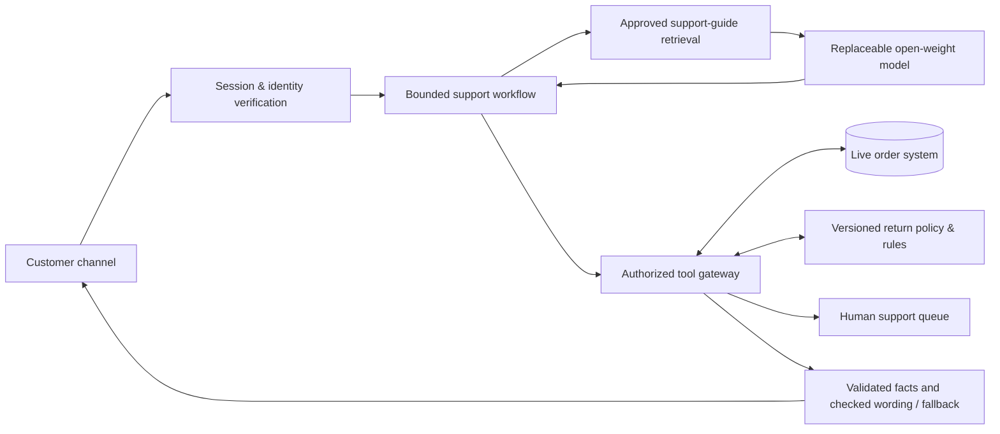

# Threadline
### Order & returns support, grounded in the order system

**AI in Management · MBA · Scenario A · Working prototype v0.6 · 8 November 2026**

> Recommend a small, supervised AI service that answers routine post-purchase questions using current order records, checks return eligibility with explicit business rules, and hands exceptions to a person with the context attached.

This repository contains the **working local prototype**, service design, and architecture for an academic consulting assignment. It connects Qwen3-8B to an API-backed synthetic order database. “Threadline” is a working concept name; the retailer and all example records are fictional.

## Preparing the team presentation

Start with the **[presentation briefing](docs/PRESENTATION_BRIEF.md)** for a slide-ready narrative, architecture diagram, speaker notes, demo script and likely questions. Read the **[complete system guide](SYSTEM_GUIDE.md)** for a self-contained explanation of the MVP. Share that file's GitHub link when asking an assistant or teammate to learn the system; some reading tools will need the individual linked files.

The **[documentation map](docs/README.md)** separates current implementation, verified local evidence, production proposals, assumptions and historical notes. The MVP uses real reads from a mutable synthetic database and a browser WhatsApp simulation. Real WhatsApp, courier, payment and retailer integrations are future work. It demonstrates specific safeguards; it is not universally hallucination-free or certified totally safe.

## Retail operations workspace

Open **http://127.0.0.1:5173** for the ERP. It includes searchable order and customer records, order creation, fulfilment editing, payment status, return processing, a support queue, conversation history, and an activity log. All counts reflect the database; no invented performance metrics are displayed.


## WhatsApp customer experience

Open **http://127.0.0.1:5173/whatsapp**, or use **Open customer chat** in the ERP header. This tab contains only the iPhone mockup. Operators manage settings and inspect conversations in the ERP.

Ask “Where is my order?”, then supply **aarav@example.com**, **+91 90000 00101**, or **CUS-1001**. The default demo setting matches an existing account directly. An unknown contact gets an explicit account-not-found reply and is not asked for a code. **ananya@example.com** is a second fictional customer. Add a new customer and order in the ERP to test a new account end to end.

Saving a selected order's status, carrier estimate, or tracking details sends a source-backed update to its connected customer chat. A subsequent AI request reads the database again. The ERP also refreshes through its own WebSocket when messages or records change. [Read the ERP design and verification notes](docs/09-erp-workspace.md).



## India store and guided returns

Catalogue prices are illustrative INR prices; policy and delivery dates use IST. Customer replies include product photographs, order details, payment status, and useful reply buttons. Return intake collects the item, reason, condition, tags, optional photos, quantity, pickup address and preferred window, then asks for explicit submission. The ERP continues through approval, carrier booking, receipt, inspection and recorded refund. No carrier booking or payment is executed.

The [return design and read contracts](docs/10-grounded-india-returns.md) explain the factual boundary and return journey. The [v0.6 conversational/RAG reference](docs/18-conversational-rag.md) explains model-written replies, approved guidance retrieval, natural return answers and safeguards. Photos and credits are bundled under [public/products](public/products/credits.json).

## Conversational support and RAG

The phone uses Qwen3-8B to understand follow-ups and draft useful replies from a versioned, 25-passage support guide. General policy questions need no email. Ask for only a tracking number, ask several order details together, describe a fit issue naturally, or interrupt a return with a question: the controller keeps the account, purchase and pending step in context.

Current order facts come from fresh authorized reads and locked factual paragraphs. Generated wording is checked before use; rejected wording falls back to the approved/source renderer. Return submission and staff decisions remain guarded workflows. ERP Conversations shows the intent, guidance, reads and actual model/fallback behavior.

Phone generation defaults to **temperature 0.2, top-p 0.8**, one model call per free-text turn. This is prompt/retrieval/decoding tuning; **the model weights have not been fine-tuned**. [Synthetic training examples and the training plan](training/README.md) are included for a future measured experiment.

## Run the prototype

Requires Node.js 20.19+ or 22.12+, Python 3.11+, and [Ollama](https://ollama.com/). The tested setup uses local Ollama, so no model API key is needed. The Q4 model download is approximately 5.2 GB; check available memory and storage for your machine.

```sh
git clone https://github.com/presish1/aim-retail-support.git
cd aim-retail-support
npm ci
python3 -m venv .venv
.venv/bin/python -m pip install -r backend/requirements.lock
ollama pull qwen3:8b
npm run dev
```

Ollama must be running. The dev command starts both Vite and FastAPI; customers, orders, returns, conversations, tickets, and activity persist in ignored `artifacts/local/threadline.db`. **Settings → Restore sample data** restores 8 fictional customers and 14 orders and clears subsequent demo activity.

For a built frontend served by FastAPI alone: `npm run build`, then `npm start`, then open `http://127.0.0.1:8000`.

Optional: copy `.env.example` to `.env` to configure another local model or compatible hosted inference endpoint. Environment variables take precedence. Keys stay on the backend; never commit `.env`. The user-selected store region is India. A production processing region and data handling terms still need an owner decision.

```sh
npm test
npm run build
.venv/bin/python evaluation/run_smoke.py --output artifacts/local/model-smoke.json
.venv/bin/python evaluation/run_conversations.py --modes baseline model --output artifacts/local/conversations.json
```

**First demo:** open customer chat → ask about an order → use `aarav@example.com` → select #4812 → find #4812 in ERP Orders → set Delivered in its inline selector → see the order update arrive in chat → ask “Can you check again?” → inspect the conversation and response evidence in ERP Conversations.

The default **Contact match · demo** setting intentionally simplifies identification for a synthetic classroom demo. Optional code verification is available under Settings; its code is visible in ERP Conversations. Neither mode is production authentication. The server binds to loopback. Return and refund records update the synthetic database only; no real payment service, retailer ERP, or WhatsApp account is connected.

The original [concept board](design/concept-board.svg) and [v0.2 screenshot](design/prototype-desktop.png) remain as design history.

## The assignment we are solving

Scenario A is a direct-to-consumer apparel retailer receiving **400 queries per day**. Order status and returns dominate. **Answers must come from a live order system.** The deliverable is an actionable recommendation for a nontechnical owner, supported by a prototype that demonstrates feasibility.

Our central design question:

**How might we give a customer a trustworthy answer and a clear next step immediately, while reserving human attention for exceptions?**

## The concept in one minute

1. A customer asks, “Where is my order?” or “Can I return the shirt?”
2. The service verifies access to the purchase and reads its current record.
3. A small language model interprets the concern and phrases a reply using approved retrieved guidance. Backend rules determine eligibility; fresh structured reads supply dates and status.
4. The customer receives the requested details and a useful next step. The compiler checks generated wording before inserting verified factual paragraphs.
5. Missing data, exceptions, and requests for a person create a handoff with verified context.

**The signature demonstration:** ask about an order, change its status in a separate demo order console, then ask again. The second answer must reflect the new database value. Turn the order API off: the service must admit it cannot check, rather than reuse the earlier answer as current.

## Recommended architecture



The phone model produces a typed intent, requested details, guidance IDs and a reply draft. The backend owns authorization, calculations, permissions, factual values and writes. A rules baseline uses the same business boundary. The older four-tool HTTP route remains for compatibility. [Read the complete current design](docs/18-conversational-rag.md).

## Read the design package

| File | What it helps the team decide |
| --- | --- |
| [Presentation briefing](docs/PRESENTATION_BRIEF.md) | Suggested presentation, speaker notes, demo narration and safe claims |
| [Complete system guide](SYSTEM_GUIDE.md) | Understand the whole MVP without starting with code |
| [Architecture](docs/03-architecture.md) | Actual layers, source map, request sequences and proposed deployment |
| [India and return design](docs/10-grounded-india-returns.md) | Current customer experience, INR/IST, return flow and screenshots |
| [Grounding and safety](docs/11-grounding-and-safety.md) | Implemented hallucination controls, threat model and remaining gaps |
| [WhatsApp integration plan](docs/12-whatsapp-integration.md) | Simulation versus real channel, webhooks, templates, media and people |
| [Business tools and scenarios](docs/13-business-tools-and-scenarios.md) | Actual model tools, internal reads and proposed courier/payment/store adapters |
| [Data and synchronization](docs/14-data-and-synchronization.md) | Source authority, revisions, transactions, offline behavior and events |
| [MVP-to-pilot plan](docs/15-production-plan-and-operations.md) | Integration gates, operational owners, evaluation and economics |
| [API and data reference](docs/16-api-and-data-reference.md) | Implemented endpoints, WebSocket protocol, records and configuration |
| [Evidence and FAQ](docs/17-evidence-and-faq.md) | What the tests demonstrate, untested areas and presentation answers |
| [Conversational support and RAG](docs/18-conversational-rag.md) | Current model role, retrieval, factual blocks, decoding and fine-tuning boundaries |
| [Documentation map and history](docs/README.md) | Reading paths and earlier definition, model, business-case and design notes |
| [Sources](docs/sources.md) | Primary references checked for the model and deployment discussion |
| [Demo data](data/README.md) | Eight synthetic customers, fourteen sample orders, an illustrative policy, and a fixed demo clock |
| [Evaluation scenarios](evaluation/scenarios.csv) | Thirty planned checks; no measured results |

## Decisions made for this first design

- Focus on order status, return eligibility, and useful escalation.
- Use a browser-based customer chat to simulate the channel in class; treat official WhatsApp integration as a proposed next stage.
- Demonstrate real reads from a mutable local database behind an API. This proves a live integration pattern, while actual retailer ERP integration remains a production task.
- The model never writes retailer orders or payments. Operators edit synthetic orders; customers explicitly submit return requests through a fixed workflow. Staff records pickup, inspection, and refund decisions.
- Evaluate a hosted open-weight model against a deterministic baseline. Buy managed inference for the pilot if a suitable deployment is available; avoid committing to GPU infrastructure before measuring the workload.
- Treat staffing, channel, policy, prices, and benefits as assumptions until verified.

## Repository status

**Completed:** operations ERP, phone-only customer channel, contextual Qwen3-8B support, local approved-guide RAG, validated generated wording, persistent records, live updates, natural return intake, failure controls, deduplicated support requests, readable response evidence and a rules baseline.

**Verified locally:** 150 backend cases and the production build pass. The [evidence register](docs/17-evidence-and-faq.md) records authored real-Qwen conversations, browser checks and their limits. These are development regressions, not an unseen benchmark or production reliability estimate. The [v0.2 smoke run](evaluation/results/local-qwen3-smoke.json) remains historical integration evidence.

**Next:** a separate held-out paraphrase/multi-turn evaluation, measured model comparison and cost analysis, then presentation evidence. An actual retailer pilot also needs its real systems, verification, and deployment review.
