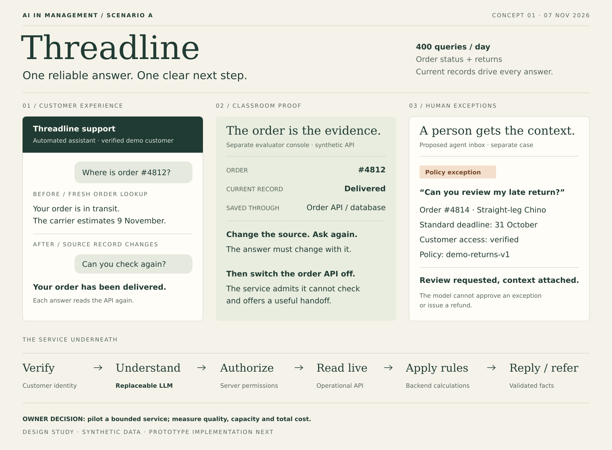
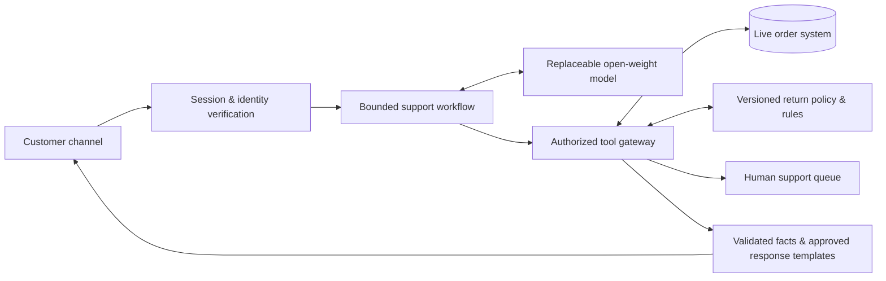

# Threadline
### Order & returns support, grounded in the order system

**AI in Management · MBA · Scenario A · Definition v0.1 · 7 November 2026**

> Recommend a small, supervised AI service that answers routine post-purchase questions using current order records, checks return eligibility with explicit business rules, and hands exceptions to a person with the context attached.

This repository is the **ideation, service design, and architecture package** for an academic consulting assignment. Implementation and model evaluation have not started. “Threadline” is a working concept name; the retailer and all example records are fictional.

## The assignment we are solving

Scenario A is a direct-to-consumer apparel retailer receiving **400 queries per day**. Order status and returns dominate. **Answers must come from a live order system.** The deliverable is an actionable recommendation for a nontechnical owner, supported by a prototype that demonstrates feasibility.

Our central design question:

**How might we give a customer a trustworthy answer and a clear next step immediately, while reserving human attention for exceptions?**

## The concept in one minute

1. A customer asks, “Where is my order?” or “Can I return the shirt?”
2. The service verifies access to the purchase and reads its current record.
3. A small language model interprets the request and selects an allowed tool. Backend rules determine eligibility; structured facts supply dates and status.
4. The customer receives a short factual answer and a useful next action.
5. Missing data, exceptions, and requests for a person create a handoff with verified context.

**The signature demonstration:** ask about an order, change its status in a separate demo order console, then ask again. The second answer must reflect the new database value. Turn the order API off: the service must admit it cannot check, rather than reuse the earlier answer as current.

## Recommended architecture

The model proposes an intent and tool arguments. The backend owns authorization, calculations, permissions, and response facts. A rules-and-template baseline uses the same backend so the team can measure the model's added value.

## Read the design package

| File | What it helps the team decide |
| --- | --- |
| [Project definition](docs/01-project-definition.md) | Problem, competing ideas, scope, assumptions, and desired outcomes |
| [Service & experience design](docs/02-service-design.md) | Customer journey, three views, conversation examples, and exception handling |
| [Architecture](docs/03-architecture.md) | Components, live-data flow, tool contracts, identity, and failure behavior |
| [Prototype specification](docs/04-prototype-specification.md) | What to build next, acceptance criteria, and a five-minute demo |
| [Models & business case](docs/05-models-and-business-case.md) | Shortlist, selection method, cost assumptions, and owner decision |
| [Evaluation & handoff](docs/06-evaluation-and-handoff.md) | Test design, pilot gates, ownership, and evidence for the slide team |
| [Sources](docs/sources.md) | Primary references checked for the model and deployment discussion |
| [Demo data](data/README.md) | Six synthetic orders, an illustrative policy, and a fixed demo clock |
| [Evaluation scenarios](evaluation/scenarios.csv) | Thirty planned checks; no measured results |

## Decisions made for this first design

- Focus on order status, return eligibility, and useful escalation.
- Use a browser-based customer chat to simulate the channel in class; treat WhatsApp as the draft's proposed production channel.
- Demonstrate real reads from a mutable local database behind an API. This proves a live integration pattern, while actual retailer ERP integration remains a production task.
- Keep the first prototype read-only with respect to retailer orders, payments, and returns. It may create a local support ticket. Eligible customers get a proposed link to the retailer's existing return portal.
- Evaluate a hosted open-weight model against a deterministic baseline. Buy managed inference for the pilot if a suitable deployment is available; avoid committing to GPU infrastructure before measuring the workload.
- Treat staffing, channel, policy, prices, and benefits as assumptions until verified.

## Repository status

**Completed:** definition, ideation, architecture, concept board, synthetic fixtures, evaluation plan.

**Next:** implement the thin vertical slice described in the prototype specification, connect a genuine model, run the evaluation, then capture the evidence for the presentation.

No retailer system, WhatsApp account, or model endpoint is connected in this version.
