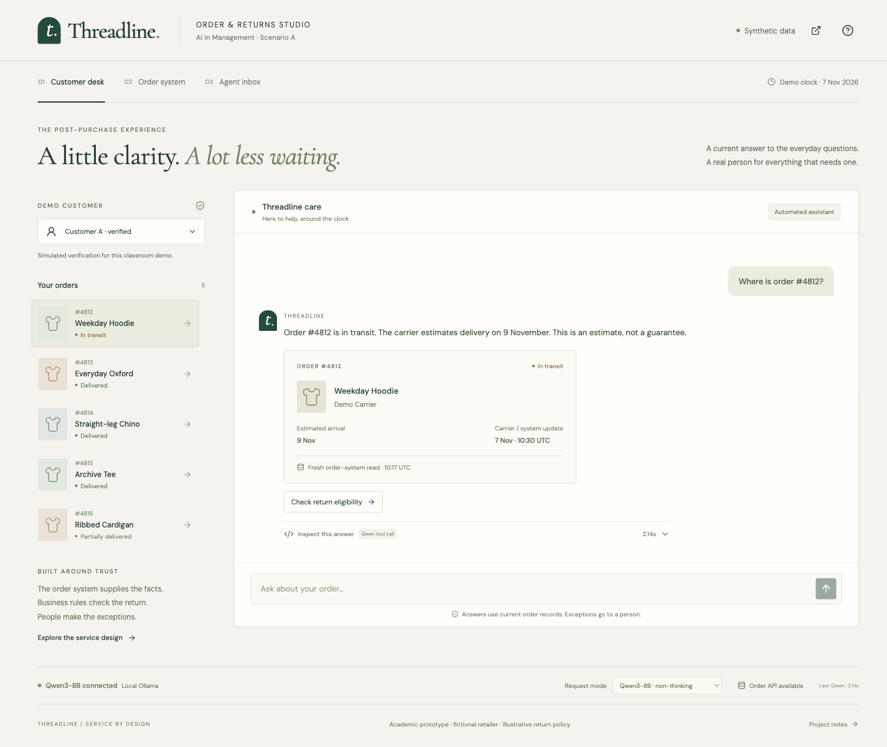
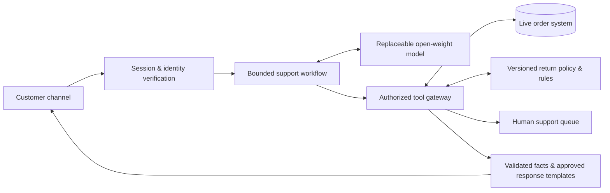

# Threadline
### Order & returns support, grounded in the order system

**AI in Management · MBA · Scenario A · Working prototype v0.2 · 7 November 2026**

> Recommend a small, supervised AI service that answers routine post-purchase questions using current order records, checks return eligibility with explicit business rules, and hands exceptions to a person with the context attached.

This repository contains the **working local prototype**, service design, and architecture for an academic consulting assignment. It connects Qwen3-8B to an API-backed synthetic order database. “Threadline” is a working concept name; the retailer and all example records are fictional.

## Run the prototype

Requires Node.js 20.19+ or 22.12+, Python 3.11+, and [Ollama](https://ollama.com/). The tested setup uses local Ollama, so no model API key is needed. The Q4 model download is approximately 5.2 GB; check available memory and storage for your machine.

```sh
git clone https://github.com/presish1/aim-retail-support.git
cd aim-retail-support
npm ci
python3 -m venv .venv
.venv/bin/python -m pip install -r backend/requirements.lock
ollama pull qwen3:8b
npm run dev
```

Ollama must be running. Open **http://127.0.0.1:5173**. The dev command starts both Vite and FastAPI; orders, sessions, tickets, and traces persist in ignored `artifacts/local/threadline.db`. Use “Restore demo fixtures” in the Order system view to reset the classroom state.

For a built frontend served by FastAPI alone: `npm run build`, then `npm start`, then open `http://127.0.0.1:8000`.

Optional: copy `.env.example` to `.env` to configure another local model or compatible hosted inference endpoint. Environment variables take precedence. Keys stay on the backend; never commit `.env`. Production US processing remains a deployment gate, not a claim about the local classroom demo.

```sh
npm test
npm run build
.venv/bin/python evaluation/run_smoke.py --output artifacts/local/model-smoke.json
```

**First demo:** track #4812 → change it to Delivered in Order system → save → ask “Can you check again?” → switch the order API off → ask again → create a handoff → inspect Agent inbox. Every response can expose its actual tool proposal, source evidence, mode, token counts, and latency.

The customer selector simulates verification. This application binds to loopback and is a local evaluator studio; its console bootstrap and customer selectors are **not production authentication**. No retailer ERP, WhatsApp account, real customer identity, return-creation API, or refund system is connected.



The original [concept board](design/concept-board.svg) records the v0.1 design direction.

## The assignment we are solving

Scenario A is a direct-to-consumer apparel retailer receiving **400 queries per day**. Order status and returns dominate. **Answers must come from a live order system.** The deliverable is an actionable recommendation for a nontechnical owner, supported by a prototype that demonstrates feasibility.

Our central design question:

**How might we give a customer a trustworthy answer and a clear next step immediately, while reserving human attention for exceptions?**

## The concept in one minute

1. A customer asks, “Where is my order?” or “Can I return the shirt?”
2. The service verifies access to the purchase and reads its current record.
3. A small language model interprets the request and selects an allowed tool. Backend rules determine eligibility; structured facts supply dates and status.
4. The customer receives a short factual answer and a useful next action.
5. Missing data, exceptions, and requests for a person create a handoff with verified context.

**The signature demonstration:** ask about an order, change its status in a separate demo order console, then ask again. The second answer must reflect the new database value. Turn the order API off: the service must admit it cannot check, rather than reuse the earlier answer as current.

## Recommended architecture



The model proposes an intent and tool arguments. The backend owns authorization, calculations, permissions, and response facts. A rules-and-template baseline uses the same backend so the team can measure the model's added value.

## Read the design package

| File | What it helps the team decide |
| --- | --- |
| [Project definition](docs/01-project-definition.md) | Problem, competing ideas, scope, assumptions, and desired outcomes |
| [Service & experience design](docs/02-service-design.md) | Customer journey, three views, conversation examples, and exception handling |
| [Architecture](docs/03-architecture.md) | Components, live-data flow, tool contracts, identity, and failure behavior |
| [Prototype specification](docs/04-prototype-specification.md) | What to build next, acceptance criteria, and a five-minute demo |
| [Models & business case](docs/05-models-and-business-case.md) | Shortlist, selection method, cost assumptions, and owner decision |
| [Evaluation & handoff](docs/06-evaluation-and-handoff.md) | Test design, pilot gates, ownership, and evidence for the slide team |
| [Implementation & measured checks](docs/07-implementation-status.md) | What works, the actual model, verification evidence, and limits |
| [Sources](docs/sources.md) | Primary references checked for the model and deployment discussion |
| [Demo data](data/README.md) | Six synthetic orders, an illustrative policy, and a fixed demo clock |
| [Evaluation scenarios](evaluation/scenarios.csv) | Thirty planned checks; no measured results |

## Decisions made for this first design

- Focus on order status, return eligibility, and useful escalation.
- Use a browser-based customer chat to simulate the channel in class; treat WhatsApp as the draft's proposed production channel.
- Demonstrate real reads from a mutable local database behind an API. This proves a live integration pattern, while actual retailer ERP integration remains a production task.
- Keep the first prototype read-only with respect to retailer orders, payments, and returns. It may create a local support ticket. Eligible customers get a proposed link to the retailer's existing return portal.
- Evaluate a hosted open-weight model against a deterministic baseline. Buy managed inference for the pilot if a suitable deployment is available; avoid committing to GPU infrastructure before measuring the workload.
- Treat staffing, channel, policy, prices, and benefits as assumptions until verified.

## Repository status

**Completed:** the three responsive views, real Qwen3-8B tool selection via Ollama, persistent API-backed order records, source updates, return rules, access boundaries, failure controls, deduplicated handoffs, actual response traces, and a rules baseline.

**Verified locally:** 29 backend tests; 12 focused integration scenarios in each of model and baseline modes; desktop and mobile browser flows. See the [implementation status](docs/07-implementation-status.md) and [recorded smoke run](evaluation/results/local-qwen3-smoke.json). These checks are not a held-out benchmark or proof of production reliability.

**Next:** a separate held-out paraphrase/multi-turn evaluation, measured model comparison and cost analysis, then presentation evidence. An actual retailer pilot also needs its real systems, verification, and deployment review.
