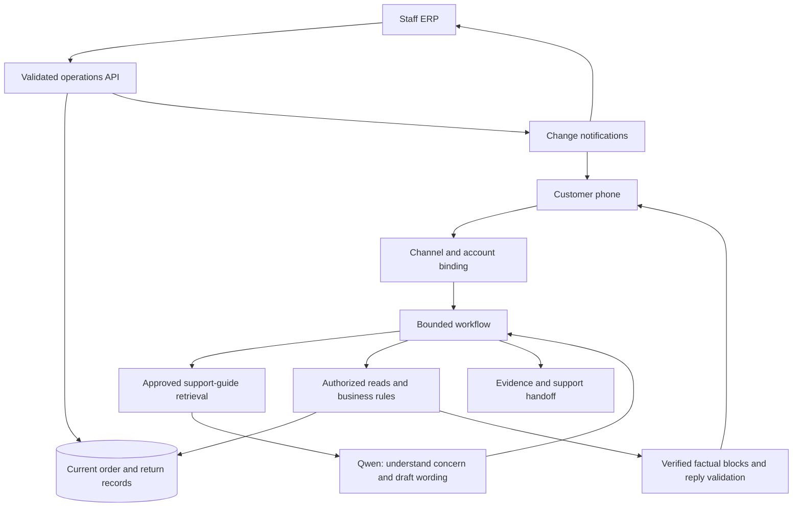

# Threadline — complete MVP system guide

**For the MBA presentation team and readers learning the system.** Local MVP v0.6, reviewed 8 November 2026. [Repository](https://github.com/presish1/aim-retail-support) · [Presentation briefing](docs/PRESENTATION_BRIEF.md) · [Documentation map](docs/README.md) · [Current conversation/RAG reference](docs/18-conversational-rag.md).

## What it actually is

Threadline is a supervised post-purchase support MVP. Customers message an apparel store, identify the relevant account and purchase, get source-backed order answers, and prepare return requests. Staff manages records, exceptions and return decisions in an operations dashboard.

The assignment's Scenario A specifies a D2C apparel retailer, 400 queries/day, an emphasis on order status and returns, and answers from a live order system. It asks for a recommendation supported by a feasibility prototype. India, INR, IST and the WhatsApp-style phone experience are later user decisions. The retailer, eight seeded customers, fourteen purchases, prices and 30-day policy are illustrative fixtures.

The MVP uses a live, mutable local database. It is not connected to a real retailer ERP, WhatsApp account, courier, payment gateway, SMS/email verification service or helpdesk. Public GitHub access shares the code and documentation; it does not host the running local app for everyone.

The management recommendation is to automate bounded information retrieval and structured intake, keep commercial decisions supervised, and measure the incremental value of natural-language routing before expanding.

## What works now, and what is future work?

| Area | Implemented MVP | Proposed production work |
| --- | --- | --- |
| Customer channel | Phone-only WhatsApp-style browser UI, real WebSocket, resume, reply buttons and photo uploads | Official WhatsApp Business Platform adapter |
| AI | Local Ollama `qwen3:8b`, typed support understanding and reply drafting, approved-guide RAG, factual blocks, rules baseline and labeled fallback | Held-out model/retrieval comparison; real weight tuning only if justified |
| Identity | Existing synthetic account match or optional local code challenge | Real customer account linking, verified possession, staff authentication and permissions |
| Data | Current SQLite customer/order/payment/return records | Existing commerce/OMS, courier and payment source adapters |
| Returns | Questions, photos, quantity/address/window, review, explicit RMA submission and staff lifecycle | Real serviceability, reverse shipment, pickup and gateway reconciliation |
| Sync | Shared database, revision checks, live workspace refresh and scoped customer updates | Durable event inbox/outbox, retry, reconciliation and multi-worker distribution |
| Evidence | Source traces, revisions, guide provenance, composition decisions, automated backend cases and authored real-model conversations | Security assessment, unseen language evaluation, provider sandbox/load tests and operating metrics |

## How does it differ from the existing system?

The retailer's actual systems have not been supplied. The following is a comparison to a **typical manual support arrangement**, to validate during discovery.

| Work | Assumed manual arrangement | Threadline's intended contribution |
| --- | --- | --- |
| Order query | Agent finds the purchase and types a status from the ERP | Contextual conversation with authorized current facts and checked wording |
| Courier exception | Agent switches to a courier portal | Proposed mapped shipment lookup and evidence-backed escalation |
| Return intake | Agent repeats questions and copies answers elsewhere | Structured, resumable intake saved with the request |
| Refund query | Agent checks internal records and possibly a gateway | Clear distinction between internal recording and confirmed external state |
| Changes after a reply | Agent notices the change and sends another message | Scoped MVP notifications; durable notification pipeline proposed |
| Accountability | Evidence reconstructed from chat history | Available read evidence, policy version and record revision |

In production this should complement existing business systems. The MVP dashboard demonstrates those operations with synthetic records; it does not prove that a new ERP is needed. If the existing helpdesk already supports equivalent automation, configuring/integrating it may be the better management decision.

There is also a useful comparison with other chatbot designs:

| Pattern | Suitable job | Difference to discuss |
| --- | --- | --- |
| Static FAQ/menu | Stable general questions | Does not by itself establish a customer's current order state |
| LLM over policy documents | Explain approved policy passages | Document retrieval alone is not a current transactional order read |
| Rules bot connected to APIs | Structured lookup and fixed workflows | Can provide the same factual controls; the MVP's model must prove added language value |
| This MVP | Contextual understanding/writing with retrieved guidance, validated live facts, return intake and staff workflow | Demonstrates how those responsibilities fit together; it is not proof of a unique capability or superiority over existing software |

Version 0.6 adds the conversational/RAG layer described below. The underlying live reads, operational records and commercial-action gates remain in place.

## Architecture in plain language

The current application is a modular monolith, not a cluster of independent AI agents. React supplies two experiences. FastAPI runs the conversation, operations and read/rule layers. SQLite stores current records. Ollama runs the model locally. An in-process hub distributes local WebSocket events. Vite proxies the development UI's `/api` traffic to FastAPI.

| Layer | Job | Main code |
| --- | --- | --- |
| Experience/channel | Phone and ERP; messages, forms, acknowledgements and reconnect | `src/WhatsApp.tsx`, `src/App.tsx`, `backend/whatsapp.py` |
| Identity/session | Bind a customer in server state; separate operator capability | `backend/app.py`, `backend/whatsapp.py` |
| Conversation workflow | Context, requested details, approved guidance, clarify, return intake or handoff | `backend/support.py`, `backend/returns_flow.py` |
| AI and retrieval | One typed understanding/writing call; approved local BM25 guide search | `backend/support_plan.py`, `backend/retrieval.py`, `backend/model.py` |
| Read/rule boundary | Ownership, source health, source validation and policy calculation | `backend/reads.py`, `backend/service.py` |
| Operations/storage | Record changes, revisions, returns, tickets and transaction checks | `backend/erp.py`, `backend/store.py`, `backend/media.py` |
| Response/evidence/sync | Compile checked wording with factual blocks, record provenance and announce changes | `backend/composition.py`, `backend/support.py`, `backend/whatsapp.py`, `src/useWorkspace.ts` |

See [the architecture reference](docs/03-architecture.md) for component and sequence diagrams.

## Three meanings of “tool”

**The current phone model produces a typed support plan and draft reply.** It identifies the concern, requested facts and relevant retrieved guide IDs. The controller then invokes allowed reads and workflows. The model cannot execute arbitrary SQL or external APIs. The following four tools remain exposed by the **older HTTP chat workflow**:

| Actual model tool | Meaning | Authority limit |
| --- | --- | --- |
| `get_order_status` | Read purchase/shipment/estimate details | Cannot choose identity or invent source facts |
| `list_my_orders` | Present the customer's purchases | No arbitrary customer search |
| `check_return_eligibility` | Evaluate the selected item or read its existing return status | Backend decides policy, deadlines and values |
| `create_support_ticket` | Save a handoff with available context | Does not issue a refund, cancel an order or approve a return |

**Internal reads** are `LiveReads.get_customer`, `list_orders`, `get_order`, `get_payment`, `get_policy` and `get_return`. The workflow calls these after validating the request. They are not six extra tools the model can freely execute. Audit names sometimes differ: `get_policy` logs `get_return_policy`.

**Business tools** are operational systems or their adapters. A real OMS/store API, courier API, payment/refund API, helpdesk, identity service, private media storage and WhatsApp adapter are proposed. Shopify, Shiprocket, Razorpay and Twilio are examples to evaluate if relevant to the retailer, not vendors already connected or selected. [The tool catalogue](docs/13-business-tools-and-scenarios.md) explains the difference and the approval required for each action.

## Walk through an order question

1. Aarav asks where his order is. The channel requests a checkout contact and finds a matching synthetic account. Unknown details do not produce a fake OTP challenge.
2. The server binds the account through the chosen demo identification mode. An order number alone does not grant ownership. When several relevant purchases exist, the customer selects one.
3. The workflow derives the order ID from explicit words or confirmed context. A model-suggested unmentioned order is not accepted as evidence of the customer's choice.
4. `get_order` reads the owned current record. It checks source health, enum/type/date fields, item totals and selected consistency conditions.
5. For a status response, `get_payment` rereads the current payment projection and checks the expected order revision. A change between the two reads produces a refresh response, rather than a mixed snapshot.
6. The support model drafts focused language using retrieved guidance and factual placeholders. The compiler requires the requested fresh facts, checks generated wording and inserts complete source-rendered paragraphs. If a check fails or the order changed during inference, the approved/source renderer supplies the answer. Action confirmations always come from the guarded workflow. Available evidence, actual inference mode and composition/fallback are recorded.
7. Staff can update fulfilment inline. The committed revision changes, an eligible selected customer conversation receives a source-backed update, and the next supported question independently rereads the source.

History supplies conversation context, not authority for a current delivery status. A fresh database fetch and a recent upstream courier scan are different things.

## How hallucinations are constrained

The central design decision is to keep transactional values outside generated prose. The model can write helpful conversational language; dates, prices, tracking IDs and status come from verified paragraphs. Accuracy is not delegated to a prompt that says “do not hallucinate.”

| Possible failure | Implemented control |
| --- | --- |
| Invented status or ETA | Fresh source projection, locked factual paragraphs and targeted prose validation |
| Unsupported general explanation | Approved retrieved guidance, guide-ID checks, instruction-leak checks and fallback; semantic errors remain possible |
| Model guesses another purchase | Explicit/confirmed reference handling plus ownership check |
| Wrong customer's data | Ownership enforced for customer-facing order reads |
| Old answer reused during outage | Current read required; source failure blocks the normal factual path |
| Guessed return deadline | Item delivery date + bound policy version + IST calculation in code |
| Missing policy | Fail/review rather than a guessed default policy |
| Invented refund amount | Purchased quantity and price; return read and transaction value checks |
| Prompt asks for immediate refund | No model refund tool; separate staff-controlled lifecycle |
| Claimed success without storage | Guarded paths report success after actual ticket/RMA/ledger persistence |

This does not guarantee zero mistakes. Sources can be wrong; the model can misunderstand an issue or add a qualitative statement that the validator misses; item heuristics, templates and rules can contain bugs; customer reports may be inaccurate; a feed may lag without a correct health signal. Tests establish behavior in defined cases, not a universal hallucination rate. [Document 11](docs/11-grounding-and-safety.md) connects controls to residual risk.

## RAG, temperature and fine-tuning

The current RAG retrieves from 25 approved support passages using local BM25 with topic boosts. It supplies explanations and response guidance; it does not store customers' orders or replace current API reads. Numeric return windows still come from the structured policy. ERP Conversations exposes retrieved/used passage IDs, version/digest, named reads and whether model wording was accepted.

Qwen3-8B runs through local Ollama. Phone defaults are temperature **0.2**, top-p **0.8**, non-thinking mode, context limit 6,144 tokens and output limit 380 tokens. One free-text turn has at most one model call; exact buttons/social turns can avoid inference. Temperature controls sampling variability. Understanding depends on the model, instructions, examples, conversation context and retrieval.

**The weights have not been fine-tuned.** This release improves prompts, retrieval, context, schema and decoding. Sixteen synthetic training examples and a genuine future tuning/evaluation plan are included under [training](training/README.md). See [document 18](docs/18-conversational-rag.md) for the full contract, examples and remaining limits.

## Why “totally safe” would be inaccurate

The defensible claim is: **the MVP demonstrates constrained source-backed answers and supervised return handling on synthetic data.** It has not passed production security certification.

Default contact matching is not authentication. Optional codes are visible in a local evaluator inbox, not sent through a real verification service. The local bootstrap exposes the operations capability, and the legacy session endpoint selects synthetic personas. Session tokens are in browser local storage. Media uses opaque local URL capabilities. Histories, addresses, traces and images lack comprehensive application-level encryption, redaction and retention jobs. The event hub is in-process; production rate limiting, durable event delivery, SSO/RBAC and external webhook verification are not implemented.

Keep this version on loopback with fictional data. These are explicit MVP boundaries, with a production plan in [document 15](docs/15-production-plan-and-operations.md), not claims that the controls already exist.

## Return journey and human responsibility

The service reads the selected owned item, policy and existing return, then offers supported intake or a review path. The customer gives a reason; reports unworn/only tried on versus worn/washed; reports garment tags attached versus removed; adds optional photos; gives quantity when needed; enters pickup address/PIN and a preferred window; reviews the summary; and explicitly submits.

Photo upload is real local functionality. Type, decoding, size and dimension limits are checked and images are re-encoded. **No vision model evaluates the photos.** A syntactically valid address or PIN does not establish courier serviceability. Missing photos, worn condition, removed tags and damage/wrong-item reasons flag staff review. Even an unflagged request still requires staff approval.

Only the final submit creates an RMA after repeated checks. A transaction deduplicates active requests for the same item. Staff then follows:

`requested → approved → pickup_scheduled → received → refunded`

Decline/reopen branches are constrained. A booking date/reference is required for recorded pickup; a passed inspection and refund reference are required for recorded refund. Stale staff edits are rejected. The local return/payment update commits atomically. **The MVP does not book a carrier, transfer money or verify bank credit.** The structured policy's automated-refund flag does not remove staff's separate ability to record a synthetic ledger entry. [Document 10](docs/10-grounded-india-returns.md) includes the full flow and screenshots.

## Real WhatsApp: what must be added?

**Proposed:** real WhatsApp → store's approved Business Platform sender → signed HTTPS webhook adapter → durable event intake → verified store account binding → existing bounded workflow → outbound messaging API → delivery/read/failure callbacks.

The current `/api/whatsapp/ws` browser connection is not the WhatsApp Business API. Production needs provider credentials, account/sender setup, webhook validation, deduplication, message-window/consent handling, supported templates, secure media retrieval and human takeover. The DOM product card will need explicit mapping to supported platform message types/catalogue records. Do not promise identical rendering on every WhatsApp client. [Document 12](docs/12-whatsapp-integration.md) separates the implementation plan from provider requirements and references.

## Synchronization and conflicting sources

**MVP:** both interfaces share FastAPI/SQLite. Staff commits use revisions/transaction checks. Change events refresh the ERP and eligible customer conversations. Reconnect reloads saved conversation/workspace state; each new supported question reads again. Order pushes target connected matched customers currently selecting that order and are suppressed during source failure. They are not a durable queue for every offline customer. A crash between commit and broadcast can lose a notification without losing the order change.

**Proposed production:** verified provider events enter a durable deduplicating inbox. Normalized field projections record provider IDs, event/ingestion times and versions. An outbox records pending outbound work with the local transaction. Workers retry/reconcile. The OMS owns purchase/fulfilment records, courier owns its scan evidence, gateway owns its payment/refund status, and staff owns inspection decisions. A local “refunded” entry does not override a gateway failure. An apparent courier delivery the customer disputes becomes an exception, not a declaration that the customer is wrong. [Document 14](docs/14-data-and-synchronization.md) covers these cases.

## Real-life additional tools

| Situation | Proposed additional tool | Safe result |
| --- | --- | --- |
| “Shipped, but where is it now?” | Tracking read for the OMS-mapped AWB/shipment | Last verified event/time; estimate only if supplied |
| “The courier never came.” | Non-delivery evidence read and support task | Investigate the dispute rather than invent an attempt |
| “Can you pick up from this PIN?” | Reverse serviceability read | Available, unavailable or unknown for the supplied shipment/address |
| “Book my return tomorrow.” | Staff-approved booking command | Confirm only after provider evidence; reconcile timeouts before retry |
| “Where is my refund?” | Gateway refund-status read | Separate internal entry, gateway state and bank-credit uncertainty |
| “I paid but have no order.” | Commerce/payment mapping reads | Escalate unmatched payment; screenshot alone does not mark paid |
| “Exchange M for L.” | Inventory read and separate exchange workflow | Distinguish available stock from a confirmed reservation/replacement |
| “Change my address after dispatch.” | OMS/carrier rule checks and staff command | No silent commercial change through model inference |

These integrations are future work. The current model does not autonomously call arbitrary courier/payment endpoints.

## MVP-to-pilot recommendation and evidence

Present the MVP's feasibility and a conditional pilot recommendation. First identify actual systems, policy, identity and budget. Replace demo identity, add a real read-only order adapter and authenticated staff access, then a verified WhatsApp adapter. Evaluate in shadow mode before customer-facing automation. Add courier reads where they solve a measured gap. Keep financial and pickup writes supervised and build provider reconciliation before enabling them.

Measure correct task/order/item selection, factual matching, disclosures/actions, handoff quality, useful-answer latency, stale sources, message failures and total cost. Count queries, cases and messages separately. Four hundred daily queries is an assignment input, not a measured peak-concurrency trace. Capacity saved is not automatically payroll cash saved.

The backend suite covers defined source, conversation, retrieval, transport and transaction conditions; many cases use baseline routing or model doubles. The current runner also executes 16 authored multi-turn scenarios in baseline and real-Qwen mode. These development regressions are not an unseen benchmark. Production language performance, load, external providers, security and ROI remain to be established. [Evidence and FAQ](docs/17-evidence-and-faq.md) records counts, results and presentation-safe claims.

## Learning from this repository with an assistant

Share this file and [the documentation map](docs/README.md), then ask:

> Explain this MVP to an MBA student. Read SYSTEM_GUIDE.md, docs/README.md and the relevant linked current references/code. Separate implemented behavior, verified local evidence, future proposals and assumptions. Walk through an order query, courier conflict and return/refund. Explain the tools, source ownership, hallucination controls, human approvals and remaining gaps. Cite repository paths; identify any file you could not fetch instead of assuming its contents.

A URL does not guarantee recursive repository access. Supply the Markdown file or specific linked documents if the reading tool cannot fetch them. The [presentation briefing](docs/PRESENTATION_BRIEF.md) is the shortest path to preparing the team's story; the remaining documents support deeper questions.
