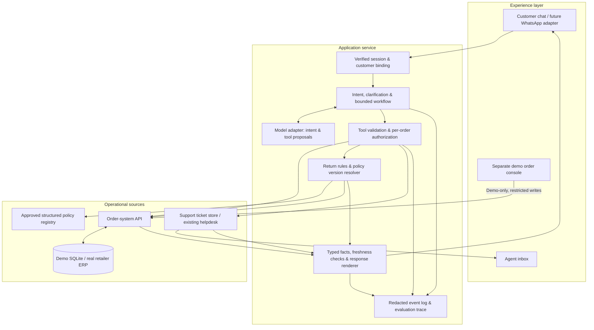
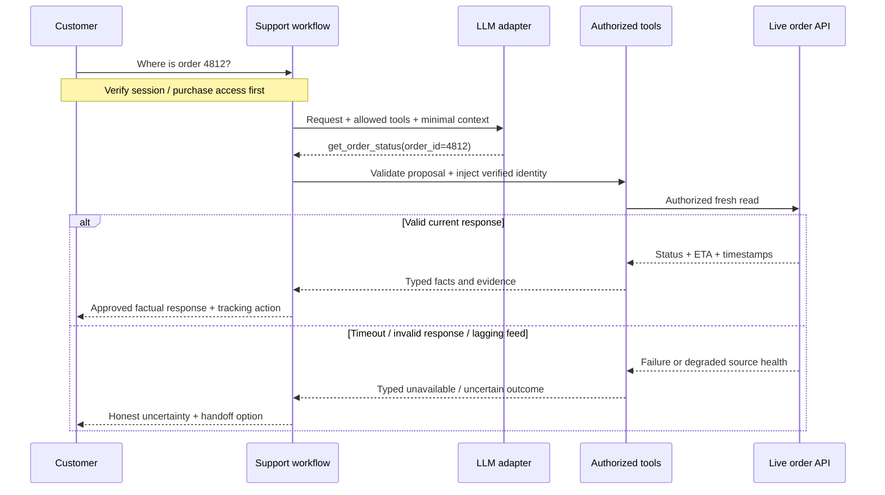

# 03 · Architecture

## Structure and responsibilities

Use one bounded workflow and a small set of authorized tools. A request can perform lookup, optional policy evaluation, then answer or hand off. Set an iteration limit and a whole-request deadline. A complex request should leave the automated path predictably.

### What the model owns

Recognize paraphrases, identify order/item references, ask for missing information, and propose an allowed tool. It may write a handoff summary from supplied evidence. It cannot select the customer's authenticated identity, query arbitrary SQL, calculate return deadlines, or authorize commercial actions.

### What the backend owns

Session/customer binding, per-order ownership checks, validated tool arguments, source reads, timestamps, policy version selection, item-level calculations, trusted URLs, ticket persistence, rate limits, and answer rendering.

For the prototype, render transactional facts in approved templates. This makes factual grounding testable and keeps the model's task focused on understanding and routing. Evaluate any future free-text paraphrasing separately; a prompt asking for accuracy is not a factual guarantee.

## Thin prototype deployment

- **UI:** React + TypeScript + Vite; responsive chat, evaluator console, handoff inbox.
- **Backend:** Python + FastAPI; same-origin API when serving a built frontend.
- **Data:** SQLite with synthetic customers, orders, items, policies, and tickets.
- **Inference:** backend-only adapter to an explicitly configured endpoint; expose model ID and mode in the evaluator trace. A rules baseline is a separate labeled mode.
- **Hosting:** local laptop for class. Any later public demo uses synthetic records and restricted demo controls. Production hosting requires verified region, access controls, and operational ownership.

These were the v0.1 proposed implementation choices. They are now implemented for the local v0.2 prototype; see [implementation status](07-implementation-status.md) for the actual tool subset, inference setup, verification, and remaining limits.

## Minimum tool contracts

The authenticated customer ID is injected by the server and never accepted from model arguments. All tools return `request_id`, `source`, `fetched_at`, and typed outcome codes. Operational records also carry `source_updated_at` and source-health metadata where available.

| Tool | Model-supplied arguments | Server-enforced behavior | Result |
| --- | --- | --- | --- |
| `list_my_orders` | None | Read only this session's orders; return minimal summaries | Owned order choices |
| `get_order_status` | `order_id` | Verify ownership; query current source; validate expected fields | Status, ETA if present, tracking URL, source timestamps |
| `check_return_eligibility` | `order_id`, `item_id`, stated condition if known | Verify ownership; fresh read; resolve bound policy; calculate in business timezone | Eligible / ineligible / needs information / review required, reasons, deadline, policy version |
| `get_return_policy` | `order_id` | Verify ownership and resolve applicable version | Approved rule summary and link |
| `create_support_ticket` | reason enum, `order_id` if known, customer request | Include verified context; persist atomically; deduplicate active handoffs | Ticket ID and actual queue state |

Candidate reason codes include `ORDER_SERVICE_UNAVAILABLE`, `ORDER_DATA_LAGGING`, `DELIVERY_EXCEPTION`, `RETURN_EXCEPTION`, `IDENTITY_HELP`, `UNSUPPORTED_REQUEST`, and `CUSTOMER_REQUESTED`.

The demo administrator uses a different API route/session to update synthetic records or inject failures. Customer tools have no update-order, approve-return, or refund capability.

## Read and answer sequence

Every new order-specific request triggers a fresh source read. Earlier conversation history is context, never evidence of current order status. A successful current query does not prove a carrier feed is current: preserve both the fetch time and upstream event/health times. An unchanged order is not automatically stale; classify feed lag using integration health and carrier-event expectations, not just record age.

For the demo, source timestamps are in UTC and the policy date calculation uses `America/New_York`. The demo clock is injectable; production uses trusted server time. Handle timezone conversion and daylight-saving changes in code.

## Return decision rules

1. Read the current order and selected item after verifying ownership.
2. Resolve the order's bound policy version; unknown/missing versions require review rather than a fallback guess.
3. Use that item's delivery timestamp. Partially fulfilled orders require item-level dates.
4. Check whether the item is already returned, final sale, undelivered, or an exception such as damage. Route damage/fault claims for review instead of blanket denial.
5. Evaluate the inclusive request deadline and required condition. If condition is unknown, ask; if customer-reported, mark initial eligibility subject to inspection.
6. Return a typed decision, reason, deadline, and approved next action. A local eligibility result does not approve a refund or override the retailer.

The illustrative policy in this repository is a design fixture, not a real retailer policy or a statement of customer rights.

## Retrieval choices

Use transactional APIs for order facts. A small, versioned, structured registry is enough for the initial return policy. If the retailer later has many policy documents, add retrieval for approved policy passages with effective versions and citations. Keep live order facts out of a document/vector index used as an answer authority. No fine-tuning is proposed for the first prototype.

## Failure and control design

- **Identity:** order number is a locator. Use existing sign-in or verified contact possession, then enforce ownership on every call. The synthetic demo identity selector must never be described as production authentication.
- **Model failure:** invalid or unsupported tool proposals cause one controlled clarification or a safe fallback. Limit calls, output tokens, tool loops, and elapsed time. Do not use model-reported confidence as permission to act.
- **Source failure:** no fabricated status or silent use of cached status. Offer handoff; display a ticket ID only after persistence succeeds. An order lookup failure does not prevent a ticket about an unavailable order.
- **Prompt injection:** customer text and operational notes are data. Only server-allowlisted tools run, with strict schemas. Do not send free-form order notes unless essential; never execute instructions inside them.
- **Privacy:** send minimal operational fields to inference. Keep contact addresses, authentication codes, and credentials out of prompts and redacted logs. Set retention according to the actual pilot agreement.
- **Portability:** keep prompts, tool schemas, policy rules, traces, and evaluation fixtures in the retailer's control. Provider adapters translate differing tool-call formats. A provider change requires rerunning evaluation.
- **Operations:** separate model spend limits from total service budgeting, track actual useful answers and failures, and provide a support-lead switch to disable automatic responses.
