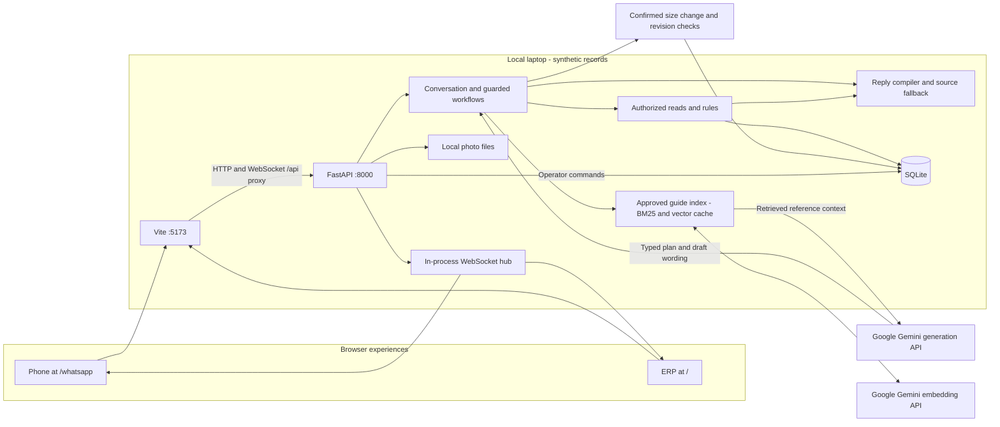
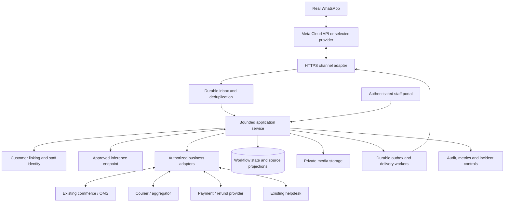

# 03 — Architecture: current MVP and proposed integrations

**Current implementation: v0.8 · 9 November 2026.** The [system guide](../SYSTEM_GUIDE.md) is the business explanation; [document 19](19-gemini-hybrid-live-data.md) specifies Gemini, hybrid RAG and the live-data contract. The production diagram is a proposal.

## The design decision

Use a bounded workflow. Gemini understands the concern and writes language from approved retrieved guidance. Backend code owns identity, permissions, factual values, calculations and writes; a compiler checks language and inserts factual paragraphs. Return intake is a state machine. RAG combines local BM25, Gemini embeddings and a local document-vector cache. No arbitrary SQL tool, autonomous agent framework or weight training is used.

## Current deployment



`npm run dev` starts Vite and FastAPI on loopback. A built frontend can instead be served by FastAPI at port 8000. The read layer currently calls SQLite in-process; it is not an outbound HTTP request to a real retailer. These are layers of one application, not separately deployed microservices.

## Layer and source map

| Layer | Responsibility | Source |
| --- | --- | --- |
| Experience | Operator tables/forms, phone messages, photos and reply buttons | [App.tsx](../src/App.tsx), [OperationsForms.tsx](../src/OperationsForms.tsx), [WhatsApp.tsx](../src/WhatsApp.tsx) |
| API/channel boundary | Request validation, synthetic sessions, local origins/capabilities, sockets, media | [app.py](../backend/app.py), [media.py](../backend/media.py) |
| Channel | Contact/code stages, sockets, message IDs, retry/resume | [whatsapp.py](../backend/whatsapp.py) |
| Conversation | Context, focused questions, guide retrieval, draft interruptions, read orchestration, handoff and traces | [support.py](../backend/support.py) |
| AI and retrieval | Typed Gemini turn, hybrid ranking, embeddings/cache and provider boundary | [support_plan.py](../backend/support_plan.py), [retrieval.py](../backend/retrieval.py), [hybrid.py](../backend/hybrid.py), [gemini.py](../backend/gemini.py) |
| Reply compiler | Required factual blocks, targeted generated-text checks and rejection reason | [composition.py](../backend/composition.py) |
| Business workflow / legacy HTTP chat | Return rules, source errors, support persistence, older four-tool route and source renderers | [service.py](../backend/service.py) |
| Read/rule boundary | Ownership, healthy source, validated records and exact policy version | [reads.py](../backend/reads.py), `Workflow.return_result` in [service.py](../backend/service.py) |
| Return application | Draft states, explicit answers and final RMA submission | [returns_flow.py](../backend/returns_flow.py) |
| Customer amendment | Owned item/size choice, explicit preview/confirmation, atomic revision + activity | [order_changes.py](../backend/order_changes.py), [store.py](../backend/store.py) |
| Operations/persistence | Customer/order/return/ticket commands; revisions and transactions | [erp.py](../backend/erp.py), [store.py](../backend/store.py) |
| Synchronization/evidence | Source-backed pushes, saved conversations, workspace reload and traces | [whatsapp.py](../backend/whatsapp.py), [useWorkspace.ts](../src/useWorkspace.ts) |

Fixture JSON seeds/resets SQLite. Runtime purchase answers use current records. Structured policy settings own eligibility and the numeric window. The separate versioned support guide supplies retrieved explanations, not order status or private records.

## Order-answer sequence

```mermaid
sequenceDiagram
    participant C as Customer
    participant CH as Channel/session
    participant W as Support controller
    participant KB as Approved guide index
    participant M as Model
    participant R as LiveReads
    participant DB as SQLite
    C->>CH: Track selected order 4812
    CH->>W: Message and confirmed order context
    W->>KB: Retrieve relevant response guidance
    KB-->>W: Passages, IDs, version and digest
    W->>M: Context, schema, approved passages and fact-block names
    M-->>W: Untrusted typed plan and reply draft
    W->>W: Validate plan; resolve actual customer reference
    W->>R: get_order(session.customer, 4812)
    R->>DB: Owned record and source controls
    R-->>W: Validated order at revision N
    W->>R: get_payment with expected revision N
    R->>DB: Current payment projection
    alt Compatible validated reads
        W->>W: Compile checked wording with fresh factual blocks or use source renderer
        W->>W: Persist read, retrieval and composition evidence
        W-->>CH: Facts, product data and actions
        CH-->>C: Saved business message
    else Unavailable, invalid, inaccessible or changed
        R-->>W: SourceError
        W-->>CH: Supported failure or handoff path
        CH-->>C: No guessed current status
    end
```

Not every phone turn invokes AI. Exact actions, social turns, menu choices and source-change notifications have paths that need no model. Free-text return answers can use model understanding; actual reported fields and state transitions are parsed/controlled separately. A failed model call uses labeled rules fallback, subject to the same source controls. A rejected generated reply can use source wording even when understanding came from the model. There is at most one model call per support turn, without repeated self-directed actions.

## Authority boundaries

- Customer text, photos, addresses and model proposals are untrusted inputs. Reporting a payment or garment condition does not prove it.
- The server chooses the bound customer ID. Order/item references are resolved from allowed context and owned records. Ambiguity still requires careful selection; heuristics are not a proof of customer intent.
- Typed validation catches specified bad data; it cannot prove that an operator's or courier's event reflects physical reality.
- Staff and customer commands have different routes. The local operator capability is an evaluator mechanism, not real staff authentication/RBAC.
- Return submission belongs to `ReturnFlow`; it is not a model-callable commercial action. Staff records later stages through the ERP. No carrier/payment call exists.
- Traces/history may contain sensitive data in a real deployment. Current logging is not comprehensively redacted or immutable.

Size changes and ETA-only notifications are documented in [document 20](20-delivery-and-order-actions.md). The model supplies intent; the controller supplies the exact preview, verifies consent and invokes a narrowly scoped transaction. Product size options are not a warehouse ledger.

## Proposed production integration shape



This proposal can remain a modular service. PostgreSQL, a managed queue, Redis or particular hosting products are options to select after discovery; none is installed or mandatory here. Multiple workers require shared event distribution and locks/state beyond the in-process hub.

Each external system retains field authority. Use live transactional APIs for current order facts; an index is not the authority for latest status. The current approved-guide retrieval can later grow into a larger policy library, preserving effective versions and remaining separate from order reads.

An outbox coordinates local state and outbound work; it cannot make an external pickup/refund and local database update one transaction. Use command intent records, provider identifiers, approved permissions and reconciliation. See [synchronization](14-data-and-synchronization.md), [tool contracts](13-business-tools-and-scenarios.md) and [production gates](15-production-plan-and-operations.md).
