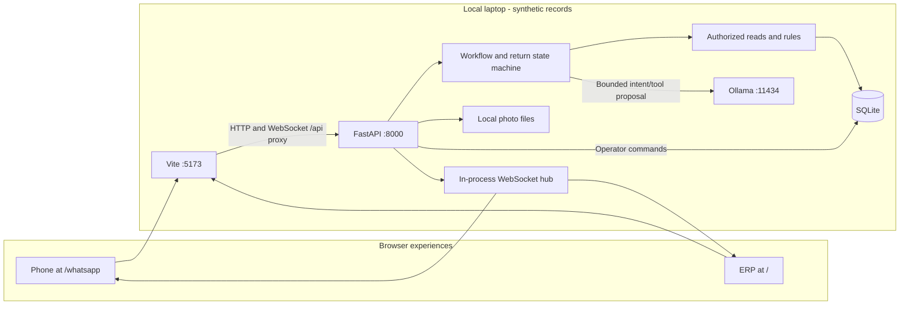
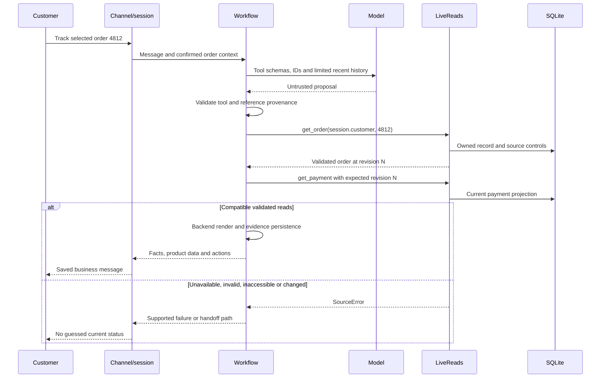
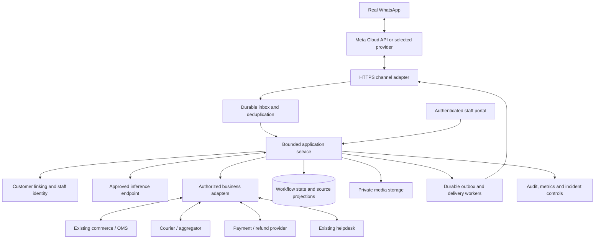

# 03 — Architecture: current MVP and proposed integrations

**Current local implementation: v0.5, code baseline `d49563f`.** The [system guide](../SYSTEM_GUIDE.md) is the business explanation; this reference maps it to the code. The production diagram is a proposal.

## The design decision

Use a bounded workflow and a small set of tools. The model interprets supported requests; backend code owns identity, permissions, calculations, writes and final transactional responses. Return intake is an explicit state machine. There is no autonomous multi-agent framework, arbitrary SQL tool, vector database or project fine-tuning in the current implementation.

## Current deployment

`npm run dev` starts Vite and FastAPI on loopback. A built frontend can instead be served by FastAPI at port 8000. The read layer currently calls SQLite in-process; it is not an outbound HTTP request to a real retailer. These are layers of one application, not separately deployed microservices.

## Layer and source map

| Layer | Responsibility | Source |
| --- | --- | --- |
| Experience | Operator tables/forms, phone messages, photos and reply buttons | [App.tsx](../src/App.tsx), [OperationsForms.tsx](../src/OperationsForms.tsx), [WhatsApp.tsx](../src/WhatsApp.tsx) |
| API/channel boundary | Request validation, synthetic sessions, local origins/capabilities, sockets, media | [app.py](../backend/app.py), [media.py](../backend/media.py) |
| Conversation | Contact/code stages, order choice, message IDs, retry/resume and pending intent | [whatsapp.py](../backend/whatsapp.py) |
| Workflow | One tool proposal, reference handling, rules/fallback, source errors, tickets, templates | [service.py](../backend/service.py) |
| AI adapter | Four schemas, inference configuration, proposal validation | [model.py](../backend/model.py) |
| Read/rule boundary | Ownership, healthy source, validated records and exact policy version | [reads.py](../backend/reads.py), `Workflow.return_result` in [service.py](../backend/service.py) |
| Return application | Draft states, explicit answers and final RMA submission | [returns_flow.py](../backend/returns_flow.py) |
| Operations/persistence | Customer/order/return/ticket commands; revisions and transactions | [erp.py](../backend/erp.py), [store.py](../backend/store.py) |
| Synchronization/evidence | Source-backed pushes, saved conversations, workspace reload and traces | [whatsapp.py](../backend/whatsapp.py), [useWorkspace.ts](../src/useWorkspace.ts) |

Fixture JSON seeds/resets SQLite. Runtime answers use current records. The policy is a structured setting; there is no document retrieval pipeline in this MVP.

## Order-answer sequence

Not every phone turn invokes AI. Identification, menu selection, deterministic return intake and source-change notifications have code paths that need no model. A failed model call uses a labeled rules fallback, subject to the same source controls. The model adapter is bounded to one proposal, not repeated self-directed actions.

## Authority boundaries

- Customer text, photos, addresses and model proposals are untrusted inputs. Reporting a payment or garment condition does not prove it.
- The server chooses the bound customer ID. Order/item references are resolved from allowed context and owned records. Ambiguity still requires careful selection; heuristics are not a proof of customer intent.
- Typed validation catches specified bad data; it cannot prove that an operator's or courier's event reflects physical reality.
- Staff and customer commands have different routes. The local operator capability is an evaluator mechanism, not real staff authentication/RBAC.
- Return submission belongs to `ReturnFlow`; it is not a model-callable commercial action. Staff records later stages through the ERP. No carrier/payment call exists.
- Traces/history may contain sensitive data in a real deployment. Current logging is not comprehensively redacted or immutable.

## Proposed production integration shape

This proposal can remain a modular service. PostgreSQL, a managed queue, Redis or particular hosting products are options to select after discovery; none is installed or mandatory here. Multiple workers require shared event distribution and locks/state beyond the in-process hub.

Each external system retains field authority. Use live transactional APIs for current order facts; a vector index is not the authority for latest status. Approved document retrieval might later explain a larger policy library, but must preserve effective versions and remain separate from order reads.

An outbox coordinates local state and outbound work; it cannot make an external pickup/refund and local database update one transaction. Use command intent records, provider identifiers, approved permissions and reconciliation. See [synchronization](14-data-and-synchronization.md), [tool contracts](13-business-tools-and-scenarios.md) and [production gates](15-production-plan-and-operations.md).
