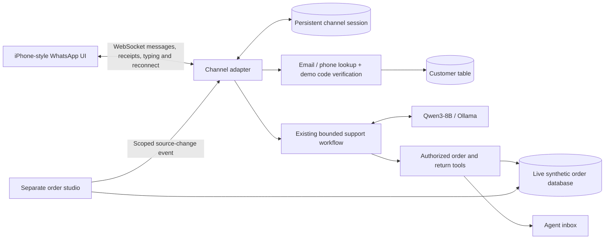

# 08 · WhatsApp customer experience

**Earlier channel/UI rationale.** Current implemented return behavior is in [document 10](10-grounded-india-returns.md); the explicit MVP-versus-real-WhatsApp plan is [document 12](12-whatsapp-integration.md). The current channel remains a browser simulation.

**v0.4 update:** the demo tab is now phone-only. The operations panel, verification codes, model settings, and traces moved into the [ERP workspace](09-erp-workspace.md). Existing-account matching is the default synthetic demo flow; code verification is optional. Unknown contacts receive an explicit account-not-found message. The following reference/design notes originated in v0.3; current behavior is described below.

The customer experience now lives in a **separate tab at `/whatsapp`**. The existing studio remains the order system, agent inbox, and evaluator view. The phone is a functional React interface, not a picture or a fake conversation generator.

## The service idea

A customer messages the store in a familiar chat. They should not have to know an internal customer ID or search for an order number before asking for help.

1. **Ask naturally.** “Hi, where is my order?”
2. **Find the account.** The assistant asks for the checkout email or phone. The backend normalizes and matches it against the customer table.
3. **Match the account.** The default demo mode binds only an existing customer record. Unknown contacts remain unmatched. Optional code mode uses a short-lived challenge with its code shown in ERP Conversations; no SMS or email is sent.
4. **Resolve the purchase.** One matching order can be selected automatically. Multiple relevant orders produce native-style reply choices, so the service asks instead of guessing.
5. **Read and respond.** Qwen3-8B selects an allowed support tool. The backend reads the current order and renders the reply from verified facts. A return question can resolve a named item such as the Oxford.
6. **Continue or hand off.** The conversation retains the selected order. Exceptions create a ticket with the context attached.

Email or a typed phone number is a lookup key, not proof of ownership. Both modes are explicitly simulated; production must use the retailer's authenticated contact/identity flow.

## Try it

Open the WhatsApp demo from the studio header or visit **http://127.0.0.1:5173/whatsapp**.

| Demo customer | Checkout email | Checkout phone | Orders |
| --- | --- | --- | --- |
| Aarav | `aarav@example.com` | `+91 90000 00101` | 4812–4816; initially two active orders |
| Ananya | `ananya@example.com` | `+91 90000 00102` | 4901 |

Start with “Where is my order?” and provide a known contact. For Aarav, choose #4812. The reply includes available item/variant, carrier, estimate, synthetic tracking reference, purchase date, total, and destination city. These are all database fields, not model inventions.

To prove the integration, keep the phone tab open and change #4812 in ERP Orders. Once that purchase is selected, a source-backed order update arrives in the conversation. Ask “Can you check again?” to perform a fresh tool read. The operator-triggered update is a deterministic system message, distinct from model inference.

## Architecture

The browser connects to `/api/whatsapp/ws`. The Vite proxy forwards WebSocket upgrades to FastAPI. Session capabilities are sent in the opening frame rather than URL query parameters. Customer messages carry stable request IDs; handled replays restore the conversation instead of repeating inference or creating another ticket. In-process connection maps support the local single-worker demo.

The transport supplies genuine acknowledgements and processing events. The tick marks represent delivery to and reading by this demo service; they are not WhatsApp network receipts. Typing indicates a real request being processed, not artificial token streaming. Reconnect uses backoff and a persisted session. Codes expire after five minutes and allow five attempts; identifiers and verification codes are not forwarded to model history.

The optional verification inbox is gated by the local demo console capability. It deliberately simulates delivery, and should not be reused as production authentication. Customer details are returned only after a successful demo match/code flow. Source-change notifications are scoped to that session's bound customer and selected order. Internal notes and response traces stay in the ERP payload instead of being sent to the phone.

## Visual direction and references

The selected direction follows the light iPhone conversation view, using a **393 × 852 logical screen** inside a proportioned device frame. The design includes a Dynamic Island, status bar, translucent circular controls, contact avatar, white incoming and green outgoing messages, tails, timestamps, read ticks, native-style business replies, composer, and home indicator. Dark mode and an optional working iOS-style keyboard support demonstrations. The wallpaper is an original local vector illustration.

Multiple iOS references were compared; older screenshots were used to understand persistent chat conventions, while the newer chat-screen reference informed the translucent controls. WhatsApp releases and account rollouts have visual variations, so this is a recreation of the chosen reference style, not a claim that every installed version is identical.

| Reference | Design evidence reviewed |
| --- | --- |
| [WABetaInfo: chat-screen rollout, June 2026](https://wabetainfo.com/whatsapp-is-rolling-out-liquid-glass-for-the-chat-interface-on-ios/) | Light and dark conversation screens; floating composer and header controls |
| [WABetaInfo: chat-screen preview, May 2026](https://wabetainfo.com/whatsapp-to-test-liquid-glass-design-for-the-chat-interface/) | Header, composer, and layering details |
| [Meta: keeping WhatsApp fresh and approachable](https://www.meta.com/design-at-meta/blog/whatsapp-user-interface-update/) | Official device-native design direction |
| [Trovaprezzi: iOS chat-interface comparison](https://www.trovaprezzi.it/magazine/tech/whatsapp-il-liquid-glass-sempre-piu-presente-nellinterfaccia-delle-chat) | Collage of chat and control treatments |
| [NuvemMag: iOS design screenshots](https://nuvemmag.com/whatsapp-iosta-liquid-glass-tasarimini-bazi-kullanicilarla-test-ediyor/) | Relative spacing, handset framing, and conversation chrome |
| [teltarif: iPhone interface comparison](https://www.teltarif.de/en/whatsapp-liquid-glass-design-update/news/103012.html) | Light/dark appearance and device context |
| [Candid Technology: iOS refreshed interface](https://candid.technology/whatsappchat-filtering-revamped-interface-passkeys-update/) | Chat-list hierarchy and filtering conventions |
| [TechTarget: illustrated WhatsApp conversation](https://www.techtarget.com/searchmobilecomputing/definition/WhatsApp) | Established message alignment and metadata conventions |

The downloaded research images remain in ignored local QA files; the application uses its own markup, icons, and wallpaper. Calling, camera uploads, and audio recording display an honest information sheet rather than pretending those services are connected.

## Verification and limits

The current suite has **66 passing backend tests**, covering ERP workflows as well as account matching, optional verification boundaries, expiry, attempt limits, preserved intent, contact exclusion from model history, order ownership, request deduplication, persistence, scoped updates, and WebSocket protocol validation.

Browser checks used genuine Qwen inference for the complete contact → verification → order selection → rich reply journey. A second studio tab changed a saved record; the phone received a WebSocket event and its next reply reflected the new source value. Reload restored the conversation. Light/dark themes, keyboard, chat-list navigation, and responsive layouts were inspected.

This remains a local synthetic prototype. A real WhatsApp Business integration would use Meta's messaging APIs and incoming webhooks in a channel adapter, with the same support workflow underneath. It would not replace the native WhatsApp client with this browser mockup. See the [official developer hub](https://whatsappbusiness.com/developers/developer-hub/) and [Meta-hosted receiving-messages documentation](https://whatsapp.github.io/WhatsApp-Nodejs-SDK/receivingMessages/) for that integration pattern; no Meta account, production credential, email/SMS service, or retailer ERP is connected here.

The current India store adds product photo messages, real local photo uploads and guided return submission. See [v0.5 return design](10-grounded-india-returns.md) for the current workflow.
