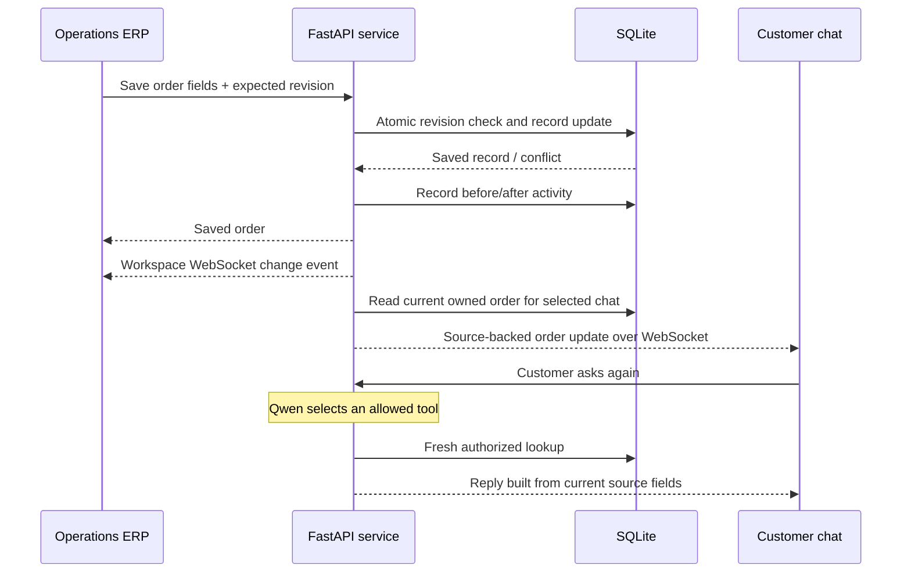

# 09 · Retail operations workspace — v0.4

The dashboard is now an operator-facing ERP. Its primary objects are customers, orders, returns, conversations, support requests, and recorded changes. The customer tab at `/whatsapp` contains only the interactive phone.

## Everyday operations

| Area | Working features |
| --- | --- |
| Overview | Database counts for orders, outstanding fulfilment, returns, and support; recent activity and conversations |
| Orders | Search by number/customer/tracking, fulfilment filters, CSV export, create an order, edit delivery/payment/priority fields, internal notes, and record timeline |
| Customers | Search contacts and customer IDs, create/edit accounts, copy a contact, inspect purchase history, and create an order from a profile |
| Returns | Create an item-level request; approve or decline; mark received; record a refund in the sample system |
| Conversations | Live customer history, selected order, account-matching stage, optional demo code, response evidence, and conversation restart |
| Support queue | Assign requests, mark them in progress/resolved, and keep internal notes with the handoff transcript |
| Activity log | Actor, timestamp, record, and before/after values for operations changes |
| Settings | Demo account matching or optional code verification; model or rules mode; source outage/feed delay/ticket failure toggles; sample-data restoration |

The interface uses compact tables, field labels, status badges, searchable records, modal creation forms, and a detail drawer. Metrics come from current records; no synthetic efficiency claims or decorative charts are inserted into the operating UI.

## Matching and customer recovery

Matching supports normalized checkout email, phone, or customer ID such as `CUS-1001`. Unknown contacts stay unmatched and receive a specific account-not-found message. They are never asked for a code for an account that does not exist.

The default `demo_match` setting binds a known synthetic account directly. This is a deliberate classroom convenience, not proof of contact ownership. Optional `code` mode retains five-minute expiry and a five-attempt limit; codes are inspected in ERP Conversations. No real delivery service is connected.

The eight sample customers and fourteen orders give the operator meaningful table/filter states. A newly created customer is immediately queryable. A newly created purchase appears in that customer's order lookup without restarting the server or reseeding data.

## Live synchronization

An edit includes an expected revision. The service rejects a stale save with a 409 response instead of overwriting another tab's changes. A saved record increments its revision and records its update time. The ERP's own WebSocket refreshes the affected workspace without polling its tables.

Status, delivery estimate, carrier, or tracking changes produce a system update only in connected conversations bound to the order's customer and currently selecting that order. The update re-reads the source, and is suppressed while the source/feed is unavailable. Internal-only edits do not generate customer notifications. Subsequent AI questions independently perform fresh reads.

System update events are recorded as `mode: system`, with zero inference usage. Model replies retain their actual Qwen/baseline/fallback mode in ERP response evidence. Internal order notes and traces are excluded from the phone's session/message payloads.

Return progress is also part of the source of truth. A return-status check reads the current return record; a request to issue a refund is still handed to a person. Operations may record a refund in the synthetic database, but no money moves. Internal return notes are never added to the customer's reply.

## Verified behavior

**66 backend tests pass.** Coverage includes customer and order creation, duplicate-contact rejection, normalized IDs, unknown-account recovery, optional code controls, ownership, revision conflicts, invalid patches, return lifecycle and transition validation, support assignment/resolution, live notification scope, and exclusion of internal notes from the customer channel.

Browser checks used the running app and genuine Qwen inference:

- An unknown checkout contact received account-not-found; a subsequent known contact recovered in the same conversation.
- An operator created Robin Taylor and a two-item-unit order totalling USD 156; the new email immediately resolved that purchase in chat.
- An operator saved #4812 as Delivered. Its selected phone conversation received the system update, then a new AI request confirmed Delivered from a fresh read.
- A return for the Oxford progressed from Requested to Approved, Received, and Refunded. The customer chat read the recorded refund state.
- A handoff appeared in Support and was assigned to the support team.
- ERP layouts were checked at 320, 390, 768, 1024, and 1500px; phone layouts at 320, 390, 768, and 1440px. Horizontal table scrolling remains inside its container. No panel, caption, or operator text remains outside the phone in the demo tab.

These are implementation checks against synthetic records, not a held-out model benchmark or evidence of production reliability. The local console capability, contact-match shortcut, and optional code inbox remain demo controls. Real identity, retailer ERP, WhatsApp Business, payment processing, and multi-worker event distribution require a separate integration stage.

## v0.5 extension

The store is now India/INR. Fulfilment has inline order controls and individual item controls. Returns include customer condition/tag answers, uploaded photos, pickup preference, carrier booking, inspection and refund reference. See [the current design and read contracts](10-grounded-india-returns.md). Verification examples above are a historical record of v0.4.
