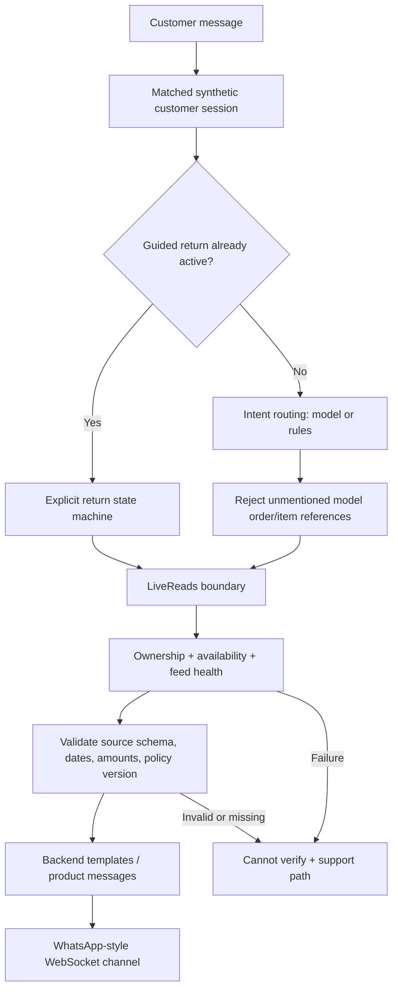
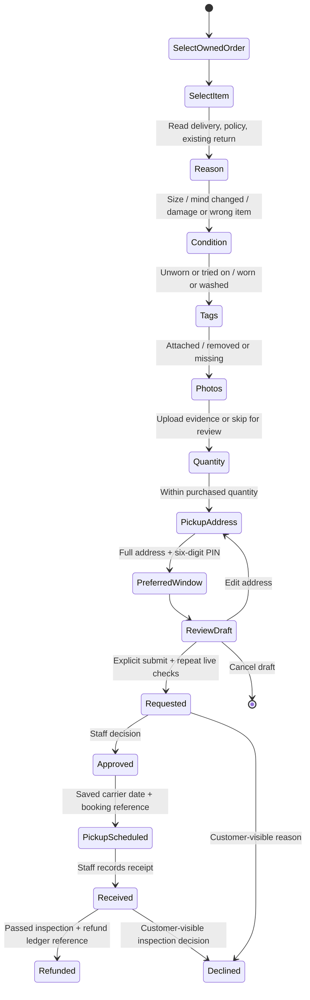
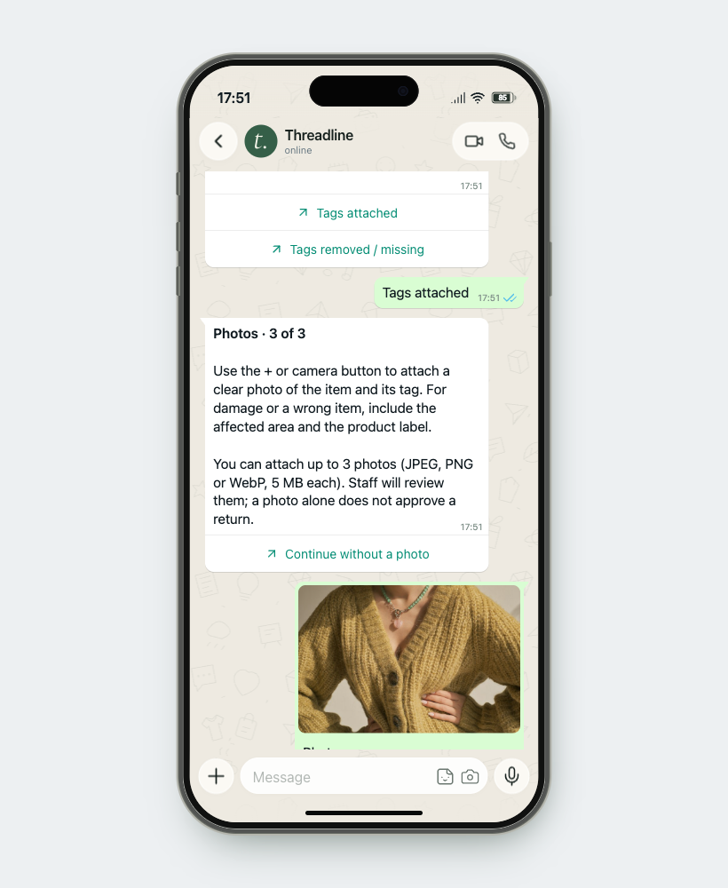
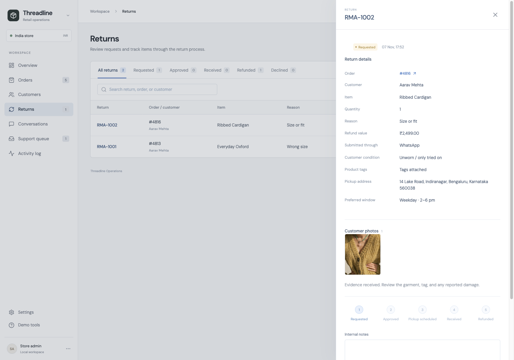

# v0.5 — India store, verified reads, and return service design

The instructor's constraint remains the same: order status and return answers must come from the current order system. India, INR, the iPhone-style WhatsApp channel, and guided return intake are the user's subsequent product decisions. The earlier draft's US setting is superseded. The 30-day policy, pickup windows, catalogue prices, and customer records are illustrative assumptions for this prototype.

## Product decisions

Customers need three things: an understandable current status, a clear next step, and continuity when the store takes over. Operators need to change the actual record quickly and see what the customer has already provided.

- The customer tab contains only the phone. Native-style message bubbles, business reply buttons, catalogue previews, photo messages, timestamps, and the composer stay inside its screen.
- Prices use INR. Delivery and policy dates use Asia/Kolkata; the standard return window ends at midnight IST after the inclusive deadline date.
- Seven locally served apparel photographs replace letter placeholders in order details and product previews. They illustrate fictional products; they are not evidence that an actual Threadline SKU exists. Credits and source URLs are in [the asset manifest](../public/products/credits.json).
- Fulfilment has an inline selector in the order table. Individual item selectors in order details support split deliveries and derive the whole-order status. Saving uses an expected revision, records the change, and broadcasts to the connected owner.

## Preventing invented transactional answers

The model is Qwen3-8B through local Ollama. Its role is bounded intent/tool selection. It cannot write the final order, refund, eligibility, or return-intake facts. State-machine questions and all factual responses are rendered by backend code.

The concrete read functions in `backend/reads.py` are:

| Function | Contract |
| --- | --- |
| `get_customer` | Read the matched account; exclude internal notes. |
| `list_orders` | Read and validate only the customer's orders; fail closed on unavailable or lagging sources. |
| `get_order` | Enforce ownership, require known status/currency/payment enums, validate timestamps, finite amounts and item totals. Ignore fields outside the customer projection. |
| `get_payment` | Read current payment status/amount/currency; reject a revision different from the order snapshot. |
| `get_policy` | Read the exact purchase policy version. Validate the fields the rules depend on. |
| `get_return` | Read the owned item's actual return. Validate status, quantity and value against the purchase. Exclude internal notes and photos from ordinary status replies. |

Every model-assisted chat response has an operator-visible trace of actual read function calls, timestamps, and order revisions. Return intake has system traces and no model inference. Source failure responses do not treat old chat history as a current record. The GET order endpoints use the same boundary. ERP state remains an operations view so staff can inspect and correct records.

This reduces the model's opportunity to invent facts; it is not a universal guarantee of correctness. An incorrect upstream record can still be reported as the source's value. Carrier freshness depends on the integration's feed-health signal, not merely a recent fetch timestamp. Real authentication, real carrier/payment integrations, held-out evaluation, and production monitoring remain future work.

## Return journey

Only the final submit creates an RMA. Before that, answers and images belong to a resumable conversation draft. Submission repeats ownership, delivery, return-window, policy and existing-return checks. A SQLite transaction prevents two conversations from creating duplicate active returns for one item. Return and payment updates commit atomically; stale staff edits are rejected with a reload path. A worn item, removed tags, damage report, or missing image flags staff review. No AI image assessment is claimed. Final-sale and expired ordinary returns offer a support review path.

Pickup address and preferred time are saved as customer-provided information, not verified serviceability or a booking. The operator must record an actual carrier booking date/reference in the demo ledger. Refund recording requires a passed inspection and reference; it does not execute a payment or promise a bank settlement date. Status changes send source-backed updates to the selected owner's conversation. Internal notes stay private; decline reasons are explicitly customer-visible.

Images are genuinely uploaded. The endpoint requires a bound session at the photo step, accepts up to three JPEG/PNG/WebP images of 5 MB each, decodes and bounds image dimensions, re-encodes JPEG to remove metadata, and stores files outside Git. Opaque local media URLs act as capabilities in this loopback classroom app; production needs authenticated private storage, scanning, retention and deletion controls.

## Demo to present

1. Open the ERP and **Open customer chat**. Use `aarav@example.com`, `+91 90000 00101`, or `CUS-1001`.
2. Ask for order #4812. The reply displays its real database product image, variant, payment, INR total, destination, tracking reference and carrier estimate.
3. Change fulfilment inline. Observe the automatic notification, then ask for a fresh status. Show the trace and saved revision under Conversations.
4. For a fresh seed, start a return for #4813; for an existing demo, use any delivered item without an active return. Answer the questions, attach a test clothing photo, enter a fictional pickup address and PIN, review, then submit.
5. Open the RMA in Returns. Inspect the answers/photo; approve, record pickup, receive, pass inspection and enter a demo refund reference. Observe each status update in the phone.
6. Turn off the order API and ask again. The app must say it cannot verify, with no recycled current status. Restore it afterwards.

Use **Settings → Restore sample data** for a completely fresh run; this intentionally clears subsequent local demo records. Keep actual personal photos and addresses out of this synthetic classroom demonstration.

## Screens from the working demo

## Reference and verification record

Business catalogue and interactive-message patterns were checked against [WhatsApp Business app features](https://whatsappbusiness.com/products/business-app-features/) and [Business Platform features](https://whatsappbusiness.com/products/business-platform-features/). The phone is a local web simulation, with no WhatsApp API account or outbound messaging. Apparel assets are licensed under the [Unsplash license](https://unsplash.com/license); individual attributions are preserved with the files.

The automated suite covers malformed records, unsupported model references, ownership, missing policies, IST deadline boundaries, live source changes, outages, explicit submission, real image upload validation, duplicate return prevention, booking requirements, and refund gates. Browser QA additionally exercises the live Qwen lookup, inline fulfilment broadcast, uploaded return photo, staff lifecycle, and responsive layouts. See the repository README for the final test count.
