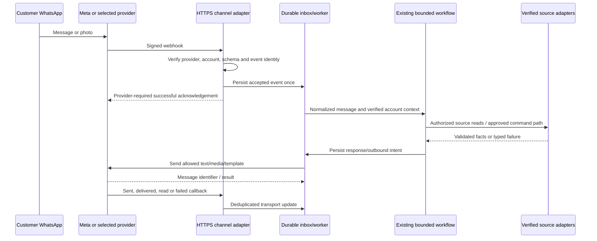

# 12 — WhatsApp: MVP transport and real integration plan

**Implemented:** a local browser simulation. **Proposed:** an official WhatsApp Business Platform channel. A realistic phone interface does not create a WhatsApp account, encrypt end-to-end through WhatsApp, or authorize outbound business messaging.

## Current browser path

`src/WhatsApp.tsx → /api/whatsapp/ws → WhatsAppChannel → Workflow/ReturnFlow → SQLite → saved message → WebSocket event`

The browser resumes with a random session token kept in local storage. Stable client message IDs, acknowledgements, per-session locks, handled flags and saved conversation snapshots support retry/resume. Photo evidence uses `POST /api/whatsapp/photo`; it is not a WhatsApp media upload. [API details](16-api-and-data-reference.md).

## Proposed channel choice

Choose one integration path after checking the retailer's account and support requirements:

| Option | Role | Tradeoff to evaluate |
| --- | --- | --- |
| Direct Meta Cloud API | Official messaging transport with our adapter | Team owns webhook, template, delivery and operational integration |
| Provider such as Twilio | Provider API/console around WhatsApp messaging | Evaluate fees, support, existing team tooling, data handling and migration constraints |

These are alternatives, not two required vendors or selected purchases. Meta publishes its [official Business Platform Postman workspace](https://www.postman.com/meta/whatsapp-business-platform/overview). Twilio documents [inbound webhooks and outbound WhatsApp messaging](https://www.twilio.com/docs/whatsapp/api). Provider-specific setup, permissions, limits and current API versions must be checked during implementation. The older Meta Node SDK is archived and is not a dependency recommendation.

## Planned inbound and outbound sequence

Acknowledge accepted events after durable intake; do not hold the webhook request open while a model runs. Failure to durably store an event needs the selected provider's retry/error behavior, not a false success response. Exact callback status codes and retry rules belong to the chosen provider contract.

## Adapter responsibilities — all proposed

1. Configure the store's business account/sender, application permissions and non-temporary server credentials through the selected provider's supported process.
2. Expose HTTPS verification and inbound endpoints. Keep challenge/verification tokens separate from payload-signing secrets and customer authentication.
3. Verify the actual provider's request signature before trusting the payload. Meta's [official signature example](https://github.com/fbsamples/whatsapp-api-examples/blob/main/signature-validation-with-webhooks-payloads/app.py) uses `X-Hub-Signature-256`; Twilio has its own [request validation procedure](https://www.twilio.com/docs/usage/webhooks/webhooks-security). Do not apply one provider's verifier to another provider's payload.
4. Scope events to the configured store/business sender, deduplicate external message/event IDs and partition work by conversation to preserve state order.
5. Normalize inbound data into channel, external message ID, store ID, sender ID, timestamp, text/button reply and optional media reference. Provider payloads are not model instructions.
6. Link the sender to an authorized retailer account. A platform phone identifier does not automatically prove access to every order whose email a person types. Handle guest checkouts, changed/recycled/shared numbers and account switching with an agreed verification process.
7. Reuse workflow/read/rule boundaries behind a channel-independent service interface. The existing `WhatsAppChannel` contains browser state assumptions, so extraction/adaptation work is required; this is not a configuration-only switch.

## Message rules and delivery state

Twilio's current documentation describes a 24-hour customer-service window after the latest inbound user message, with approved templates required for outbound messages outside that window. Its [best-practices guidance](https://www.twilio.com/docs/whatsapp/best-practices-and-faqs) also discusses opt-in. Recheck these rules for the selected account/provider at launch; this document is not a rate card or legal opinion.

**Our proposed implementation:** store last inbound time, consent/opt-out state, template identifiers/language and delivery status. Before every proactive update, check whether and how it may be sent. A useful order update must not bypass the transport policy. If sending is unavailable, preserve pending work and expose its state to staff rather than claim delivery.

Distinguish response generated, queued, accepted by provider, delivered, read and failed. An API success or message ID is not proof the customer received/read it. The MVP's browser ticks are a local transport simulation, not Meta delivery receipts.

## Mapping the customer UX

| MVP interaction | Proposed real-channel mapping |
| --- | --- |
| Text/bold fields | Supported text formatting within provider limits |
| Many order options | Supported interactive list or an explicit numbered selection; respect current limits |
| Reply buttons | Supported interactive replies with stable internal identifiers |
| Product preview | Approved media/caption or configured catalogue message; a DOM card is not directly portable |
| Photo upload | Receive provider media ID; authorized server retrieval; decode/scan/store privately; attach evidence to draft |
| Contact match/code | Real retailer account linking/verification, outside the LLM's control |
| Staff notification | Current source read plus permitted outbound type/template and delivery tracking |

Media URLs are transient/provider-controlled. Fetch only through the allowed provider API, bound to the correct message/account; validate type/size and store in private storage. Do not give the model arbitrary URLs to fetch or send local opaque demo URLs to real customers.

## Human takeover and acceptance gates

**Proposed:** an explicit automation/agent-owned conversation state, assigned person/queue, transcript and verified evidence. When a person takes ownership, suppress automatic replies that could contradict the agent. Resume only through a deliberate workflow rule. The MVP persists tickets and assignments but does not implement a complete production agent/bot ownership lock.

Before pilot: prove signed ingress and tamper rejection, duplicate handling, account isolation, order ownership, media retrieval, supported message rendering, template/window/opt-out handling, failed/reordered callbacks, human takeover, restart recovery and reconciliation in a provider sandbox. Keep production credentials out of frontend code, prompts, Git and screenshots. See [the rollout gates](15-production-plan-and-operations.md).
