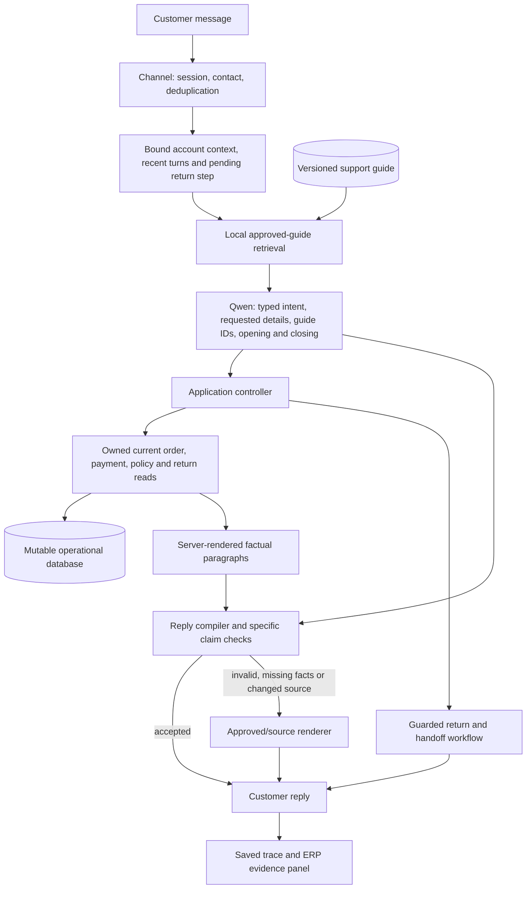
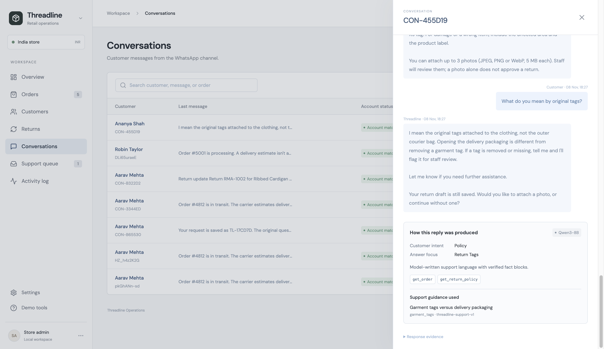

# 18 — Conversational support, RAG and model tuning

**Implemented in local MVP v0.6 · 8 November 2026.** This is the current phone-chat design. The earlier four-tool HTTP workflow remains for compatibility. All accounts, orders and policies are fictional; no external retailer, courier or payment integration is implied.

## What changed

The earlier chatbot selected a tool and returned a fixed operational message. It often asked for an email before answering a general question, repeated an entire order when the customer wanted one detail, and required exact return-button wording.

The phone now uses one structured model turn to understand the concern, use recent customer turns and workflow context, select relevant guidance and write an opening and optional next step. The controller resolves the account and purchase, executes fresh reads, inserts the requested factual paragraphs between those parts, advances return intake and persists permitted actions. General questions need no account match. “Just the tracking number” gets that detail, rather than the whole order again.

This is a hybrid design: model-written conversation, retrieved approved explanations, deterministic business controls and an explicit fallback. Business rules, consent and accurate identifiers intentionally remain in code. It is not unrestricted generation or a promise that every message is generated by AI.

## An answer, layer by layer



These are modules of one FastAPI application. There is no autonomous agent swarm. An exact button, greeting or numeric choice can take a zero-model-call path. A free-text support turn uses at most one model call for understanding and wording together, with a labeled fallback on failure.

## What the RAG actually retrieves

[support-guides.json](../data/support-guides.json) contains 25 approved, fictional support passages. They cover identity questions, tracking, uncertain estimates, delivery disputes, tags versus packaging, photos, return steps, refund timing, unknown fees, address changes, cancellations, exchanges, payments and human support.

Each passage has an ID, title, topics, example query terms and an approved customer explanation. The entire file has a version. [retrieval.py](../backend/retrieval.py) builds a local BM25 index with small token aliases. When supported topics are available it limits candidates to those topics, then ranks with BM25/topic boosts; otherwise it uses lexical ranking. It retrieves up to four planning passages. After understanding the request, the controller retrieves the answer topics and can fetch a required passage by ID. This deterministic fetch is recorded too; it is not evidence that the model independently retrieved that passage.

The model receives approved reference explanations and must select guide IDs from the supplied passages. Its JSON schema restricts IDs to those retrieved. The trace distinguishes **planning passages**, **answer passages**, and **used guide IDs**. IDs, version, file source, digest and ranking scores are available to the operator. These are provenance and retrieval scores, not calibrated confidence probabilities.

No vector database, paid embedding call, upload indexing or customer-transcript indexing is needed for this small knowledge base. This is lexical retrieval-augmented generation, not vector RAG. A larger/multilingual library might justify embeddings or hybrid retrieval only after comparing retrieval quality.

### Updating the guide

1. Edit the approved passage and its query terms in `data/support-guides.json`.
2. Increment its file-level version, review the business claim and run the regression checks.
3. The index refreshes when the file's modification signature changes; no model training is required.
4. If the guide digest changes while a model reply is being generated, the controller uses the approved/source renderer for that turn.

The file is developer/owner maintained; there is no approval CMS, malicious-file scanner or production publishing workflow. Invalid guide content needs a valid rollback; do not equate a version string with verified policy authority. The structured policy record remains authoritative for the numeric return window and eligibility calculation.

## Fresh facts versus conversational language

The model contract excludes order numbers, amounts, dates, tracking references and transactional statuses from generated prose. It supplies an `opening` and `closing`. The controller chooses the factual paragraphs from the actual requested facets and internally constructs a template such as:

```text
Here are the parcel details you asked for:

{{fact:tracking}}
```

After an owned fresh read, the compiler inserts the actual tracking reference and carrier. Blocks include `status`, `eta`, `tracking`, `payment`, `total`, `items`, `destination`, `return_status`, `catalog`, `policy_window` and `return_conditions`. A block is a full paragraph. The model does not have to reproduce placeholder syntax or remember to include a required tracking number. Unavailable or unrequested references, and blocks embedded inside generated sentences, are rejected. Return progress currently uses the guarded source renderer.

For a factual answer, the controller inserts the relevant blocks. The compiler rejects unknown placeholders, omitted required facts, unretrieved guide references, unprotected numbers/links, specified status/action claims, positive financial/delivery guarantees, invented causes, sensitive-data requests and leaked writing instructions. It also rejects wording based on an order revision that changed during inference. The guarded source-rendered fallback reflects the current validated source.

The model can still misunderstand an issue or produce an unsupported qualitative statement that these checks do not recognize. These are targeted validation rules, **not a universal semantic entailment proof**. Upstream data and approved guide text can also be wrong. A lower temperature does not establish truth. Customer account/staff authentication and production security remain separate concerns; see [grounding and safety](11-grounding-and-safety.md).

## Conversation and return behavior

| Customer situation | Implemented behavior |
| --- | --- |
| “How long do refunds take?” before identifying | Explain approved process and bank-time uncertainty without demanding an email or creating a ticket |
| “When will it arrive?” after choosing a purchase | Use selected owned order; read the latest estimate; avoid asking for contact again |
| “What did I buy, what was the total, and was it paid?” | Include the requested item, total and payment blocks |
| “I need it for a wedding” | Acknowledge urgency, use the current estimate, offer a real store investigation without promising faster delivery |
| “Yes please” after that offer | Save a real support ticket with the original concern and acceptance; do not claim a person has joined |
| “The shirt is too tight” during intake | Record the supported fit reason and ask the next unanswered question |
| “Only tried it on; tags still attached” | Record both reported fields and avoid asking them again |
| “I haven't washed it” | Ask whether it was worn; absence of washing does not prove unworn condition |
| “What do you mean by tags?” midway through intake | Retrieve the packaging/tag explanation, keep the draft and resume its pending question |
| “Actually I removed the tag” | Correct the same draft and flag staff review rather than silently retaining the old answer |
| “I want a person” during a return | Save a handoff and preserve the return draft |
| A new contact is supplied | Clear the old account selection/draft/pending concern; limit model history to the new account context |
| “Return the white shirt” while tracking another purchase | Resolve actual customer words against owned items; clarify ambiguity rather than trust a model-invented item hint |

Reported return fields are conservatively parsed from the actual customer message. The model does not supply condition, tags, quantity or consent. This implementation supports a defined English vocabulary and negations, not arbitrary multilingual slot extraction. An unclear answer prompts clarification. Explicit submission remains mandatory; “yes” alone is not an RMA submission. The model has no refund, pickup-booking, stock-reservation or order-edit tool.

## Model settings and what “fine-tuning” means here

Current phone defaults, read by the backend at startup:

| Setting | Value | Purpose |
| --- | --- | --- |
| Model/provider | `qwen3:8b` / local Ollama | Existing open-weight model |
| Temperature | `0.2` | Limit wording variability while allowing natural responses |
| Top-p | `0.8` | Limit sampling to a narrower probability mass |
| Repetition penalty | `1.05` | Discourage unnecessary repetition |
| Thinking | Disabled | Bounded local response generation |
| Context/output limits | 6,144 / 380 tokens | Bound this structured planning/writing call |
| HTTP timeout | 30 seconds | Fail into a labeled supported path |
| Model calls | At most one per support turn | Avoid separate router/writer inference loops |

Use `THREADLINE_SUPPORT_TEMPERATURE` and `THREADLINE_SUPPORT_TOP_P` in a local `.env` to change sampling. Temperature is clamped to 0–0.7 and top-p to 0.1–1. Restart the backend after changing environment settings. Defaults are practical starting points verified on this local model; they are not a measured global optimum. The legacy four-tool HTTP route retains its older temperature-0 configuration.

**No weights have been fine-tuned.** This release tunes the system prompt, task examples, context, retrieval, output schema and decoding settings. Understanding comes from the model plus useful instructions/context/retrieval; temperature controls sampling, not understanding by itself.

[training/support-examples.jsonl](../training/support-examples.jsonl) contains 16 synthetic input/target examples for review and future training. They are not silently loaded as trained weights. [The training plan](../training/README.md) explains how a genuine SFT/LoRA experiment would need approved examples, privacy review, a separate held-out set, an actual training run, an adapter artifact and comparison against the same base-plus-RAG system. No successful fine-tuning or adapter deployment is claimed.

## Inspecting and testing a reply

ERP → Conversations → select a conversation → **How this reply was produced** shows intent, requested focus, actual mode, named business reads, guidance and whether generated wording was accepted. Raw response evidence remains available. Source-rendered action confirmations are intentional; a trace can show model understanding even when final wording comes from the guarded renderer.



[Phone example: a tag question answered without losing the return draft](../design/whatsapp-contextual-return.png).

```sh
npm test
npm run build
.venv/bin/python evaluation/run_conversations.py --modes baseline model --output artifacts/local/conversations-v06.json
```

The conversation runner uses isolated temporary databases and the actual configured model in model mode. It refuses to count a missing model as genuine inference. It records per-turn mode, text, guide provenance, composition/fallback, tokens and timing. Its 16 authored scenarios are development regressions used while building the feature, **not unseen accuracy, customer satisfaction or business-impact evidence**. [The evidence register](17-evidence-and-faq.md) records the final local results and remaining evaluation work.

## Code map

| File | Responsibility |
| --- | --- |
| [support.py](../backend/support.py) | Context, retrieval orchestration, focused answers, source reads, return interruptions, handoff and traces |
| [support_plan.py](../backend/support_plan.py) | Typed intent/facets/guide IDs/opening/closing, model prompt, deterministic reported fields and fallback interpretation |
| [retrieval.py](../backend/retrieval.py) | Local BM25 guide index, refresh and provenance |
| [composition.py](../backend/composition.py) | Locked factual blocks, targeted generated-text checks and rejection reasons |
| [support-guides.json](../data/support-guides.json) | Owner-maintained approved support reference |
| [test_support.py](../backend/tests/test_support.py) | Conversation, retrieval, composition, privacy-boundary and failure regressions |
| [run_conversations.py](../evaluation/run_conversations.py) | Reproducible authored baseline/real-model conversations |

For the presentation: **“The AI understands and phrases the answer using approved retrieved guidance; business functions supply current facts, and the application controls actions.”** Describe the tested controls and the remaining gaps rather than promising total safety or zero hallucinations.
