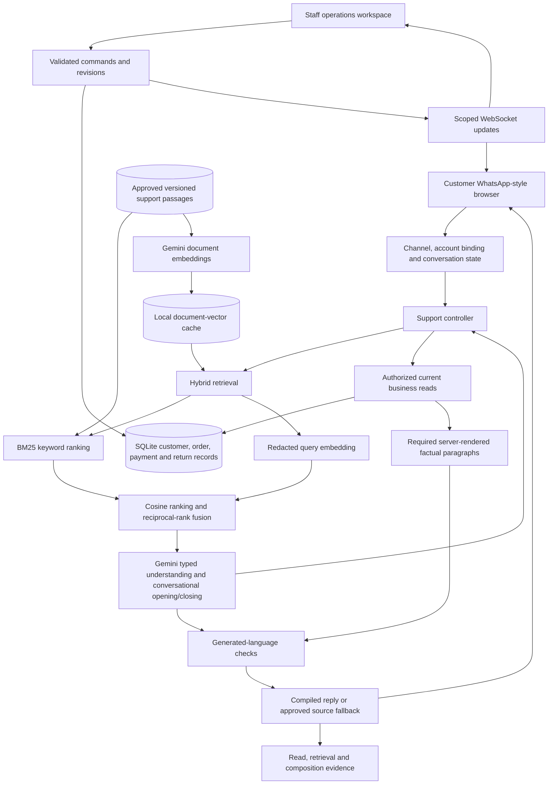
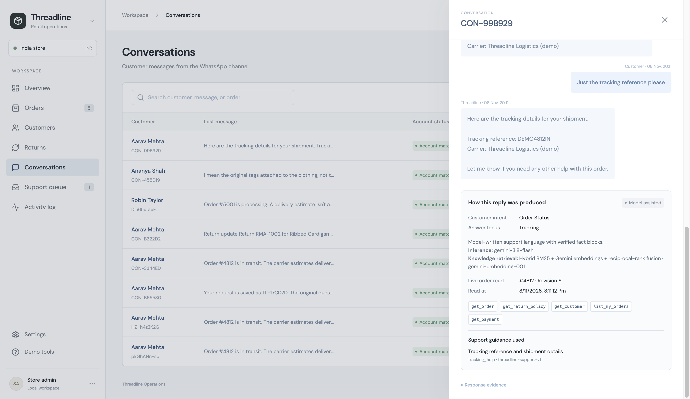

# 19 — Gemini, hybrid RAG and live operational data

**Current MVP v0.8 · 9 November 2026.** This supersedes the v0.6 model/retrieval settings. Fine-tuning is outside the current scope; no weights or adapters are trained. The implementation uses Gemini generation, a real semantic/lexical retrieval pipeline, authorized current database reads, guarded return/size-change workflows and inspectable evidence.

## Presentation explanation

> Threadline is a customer-support application that combines approved knowledge retrieval with current operational data. Gemini understands the customer's concern and writes conversational language. Hybrid RAG finds relevant guidance even when the customer uses different words. Business functions read the customer's current orders, payments, policy and return records. The server inserts factual paragraphs and controls actions, so model fluency cannot authorize a refund or replace an unavailable order source.

The retailer and all fixture records are fictional. Gemini generation and embedding API calls are real. The mutable SQLite database is real local persistence behind the application API; it is not yet a connection to a retailer's actual OMS. The WhatsApp interface remains a browser simulation using a real WebSocket.

## Architecture and authority



| Component | Job | Authority limit |
| --- | --- | --- |
| Channel/session | Resume messages, preserve intent and pending intake, bind fictional account | Contact matching is a demo shortcut, not production authentication |
| Hybrid RAG | Retrieve approved explanations | A similarity score does not establish a current order fact |
| Gemini | Understand intent/requested details, select supplied guide IDs, write opening/closing | No arbitrary SQL, unrestricted HTTP, financial execution or account selection |
| LiveReads | Read owned customer/order/payment/policy/return projections | Validates defined source fields and source health; cannot prove physical delivery |
| Reply compiler | Insert required factual paragraphs and reject specified unsupported claims | Targeted checks, not a universal semantic truth proof |
| Return application | Preserve reported condition, tags/photos, address, explicit submission and staff stages | A saved RMA is not a booked pickup or transferred refund |
| ERP/storage/events | Persist operator changes, check revisions and notify eligible sessions | Local in-process distribution is not a durable multi-provider event system |

## The RAG pipeline

1. **Approved corpus:** 26 passages in [support-guides.json](../data/support-guides.json), with ID, title, topic, query terms and customer-facing explanation. No customer order, transcript or upload is indexed.
2. **Document embeddings:** `gemini-embedding-001` creates 768-dimensional vectors for the passages using `RETRIEVAL_DOCUMENT`. Vectors are normalized and cached under ignored `artifacts/local/retrieval/`.
3. **Cache identity:** corpus digest, embedding-model ID and dimension form the cache key. Document IDs/count/dimensions and finite values are checked before reuse. A guide edit causes re-embedding; incompatible model spaces are not mixed.
4. **Query preparation:** email-like strings and numeric identifiers are masked before a `RETRIEVAL_QUERY` embedding. Query text/vectors are used for that request and are not stored in the document index. This is limited masking, not comprehensive PII scrubbing.
5. **Candidate selection:** recognized supported topics narrow the corpus. Without a known topic, all approved passages are candidates. Incorrect intent/topic interpretation remains a retrieval risk.
6. **Two rankings:** BM25 handles exact support terms; normalized-vector cosine similarity handles semantic phrasing.
7. **Fusion:** reciprocal-rank fusion combines the lists with `1/(60+rank)` per ranking. Up to four passages enter the planning context. Cosine/BM25/fusion scores are ranking evidence, not calibrated confidence.
8. **Generation:** Gemini receives current workflow context, approved passages and a typed output contract. Guide IDs are limited to the supplied set. Its output specifies intent, requested facets and conversational opening/closing.
9. **Answer selection:** the controller can also fetch a required approved passage by topic/ID after planning. The trace distinguishes planning passages from final answer sources; this is not an autonomous model tool loop.
10. **Failure:** if semantic retrieval fails, an explicit trace flag records lexical-only retrieval. If the corpus changes during embedding, old vectors are not fused with new passages. If generation fails, labeled rules fallback uses the same live-data controls.

This is a small vector index implemented directly in Python over 26 passages. A vector database service would add infrastructure without improving the demonstration by itself. The corpus/version/provenance boundaries are the important design choices; a larger deployment may replace the storage implementation after measurement.

## The database is the source of operational truth

RAG explains policy and process. These named reads establish the supported operational answer:

| Read | Source and checks |
| --- | --- |
| `get_customer`, `list_orders` | Bound account and its owned purchases |
| `get_order` | Current owned record, healthy source/feed, strict schema, dates, amounts and selected consistency checks |
| `get_payment` | Current payment projection with the expected order revision |
| `get_policy` | Exact applicable structured policy version; numeric return window and IST calculations |
| `get_product_sizes` | Healthy source; enabled size options for the exact SKU, not stock availability |
| `get_return` | Owned RMA, status, quantity/value and customer-safe public projection |

These are application-controlled functions in [reads.py](../backend/reads.py), not arbitrary model-generated SQL. The database schema and routes remain documented in [document 16](16-api-and-data-reference.md).

**Example:** the customer asks for the delivery date. The application reads order revision 1 and replies using its estimate. Staff changes the estimate and commits revision 2. A subsequent request reads revision 2 and uses the new value. The transcript, vector cache and model memory are not consulted as authorities for the latest estimate. If the source is unavailable, a previously correct date is not repeated as current.

Dependent payment reads check the order revision. If the order changes during inference, generated framing is discarded in favor of the fresh source-rendered answer. Responses still describe a read snapshot: another edit can happen after that snapshot. Existing scoped notifications and reconnect behavior remain as described in [synchronization](14-data-and-synchronization.md).

## How a customer reply stays grounded

The controller determines the requested factual paragraphs and inserts them between generated language. Examples include status, ETA, tracking reference, payment, total, items, destination and policy window/conditions. Exact facts are supplied by current validated reads, rather than copied from the model's prose.

The compiler checks unknown/unrequested references, missing required facts, supplied-guide provenance, unprotected numbers/links/status claims, specified action confirmations, positive guarantees, invented causes, sensitive-data requests and leaked internal instructions. Failed checks use approved/source-rendered text and record the reason. Return questions/action confirmations intentionally use the guarded workflow renderer.

The model cannot execute a refund, reserve inventory, book a carrier or directly modify an order. The controller now permits a customer-confirmed same-SKU size change on an owned unfulfilled order, with current reads, a revision-bound preview and an atomic size/activity transaction. [Document 20](20-delivery-and-order-actions.md) specifies this narrow action boundary. Staff records synthetic lifecycle stages after the existing checks. No carrier/payment command is executed.

**Remaining risk:** a model can misunderstand the issue or add an unsupported qualitative statement that the checks miss; a guide, operator or upstream source can be wrong. Neither RAG nor a stronger model establishes zero hallucinations or total security. Current demo identity, media/log retention and event-delivery gaps remain in [the safety case](11-grounding-and-safety.md).

## Gemini configuration and credentials

| Setting | Current value |
| --- | --- |
| Generation model | `gemini-3.8-flash` |
| API | Native REST `models/{model}:generateContent` |
| Structured output | JSON schema + Pydantic validation |
| Sampling | Provider defaults; no temperature/top-p/top-k fields sent |
| Thinking | `LOW` |
| Output / timeout | 2,048 tokens / 30 seconds |
| Embeddings | `gemini-embedding-001`, 768 dimensions, 8-second HTTP timeout |
| Model calls | At most one generation call per free-text support turn; exact actions can avoid it |
| Retrieval calls | One query embedding per supported model-planning turn; document batch embeddings only on cache rebuild |

Gemini 3.8's [migration guidance](https://ai.google.dev/gemini-api/docs/latest-model) says to remove older sampling controls. The previous Qwen temperature 0.2/top-p 0.8 settings are not copied to this provider. See [structured output](https://ai.google.dev/gemini-api/docs/structured-output) and [embedding documentation](https://ai.google.dev/gemini-api/docs/embeddings).

Copy `.env.example` to an ignored local `.env`, add `THREADLINE_MODEL_API_KEY`, and restart the backend. The key is used only in backend request headers, never frontend code, query URLs, prompts or committed results. Provider error bodies are not copied into support traces. The configured inference/cloud-processing description is metadata, not a guarantee of a particular geographic processing region.

Cloud inference requires internet, quota and API access; customer free text may reach Google. This prototype uses fictional data. A real retailer must review the selected paid service's data handling, minimize/redact personal data and replace demo account/staff identity. Cached guide embeddings consume little local space compared with model weights. The two user-authorized local Ollama models were removed; Ollama is optional compatibility infrastructure, not required to run this version.

## Verification and presentation evidence

```sh
npm test
npm run build
.venv/bin/python evaluation/run_conversations.py --modes baseline model --output artifacts/local/conversations.json
.venv/bin/python evaluation/run_retrieval.py --output artifacts/local/retrieval.json
```

The conversation suite includes real Gemini calls plus controlled temporary database mutations: changed estimates/tracking, source outage, account isolation, compound factual questions and return interruptions. The retrieval runner separately compares lexical versus hybrid retrieval over 14 authored queries. Unit tests exercise provider errors, incomplete/invalid output, secret-safe failures, cache invalidation, corpus changes and fallback without making paid calls.

These are authored development regressions, not unseen accuracy or proof of a “100x” improvement. [The evidence register](17-evidence-and-faq.md) records actual results and limits. Real test reports are in [Gemini conversations](../evaluation/results/v08-gemini-conversations.json) and [retrieval comparison](../evaluation/results/v08-retrieval.json). The older Qwen results remain labeled historical.

ERP Conversations now shows the actual inference model, retrieval method/embedding model, source guide IDs, order revision, fetch time, named reads and composition decisions. These are useful presentation evidence for explaining the system beyond a chat screen.



## Code map

| File | Responsibility |
| --- | --- |
| [gemini.py](../backend/gemini.py) | Native structured generation, provider failure handling, usage and key boundary |
| [hybrid.py](../backend/hybrid.py) | Embeddings, document cache, normalization, fusion and lexical fallback |
| [retrieval.py](../backend/retrieval.py) | Approved corpus loading, version/digest, topic candidates and BM25 |
| [support.py](../backend/support.py) | Context, orchestration, current reads, focused answers, return interruptions and traces |
| [composition.py](../backend/composition.py) | Required factual paragraphs and targeted generated-language checks |
| [reads.py](../backend/reads.py), [store.py](../backend/store.py) | Authorized current facts, revisions and persistent workflow records |
| [test_gemini_rag.py](../backend/tests/test_gemini_rag.py) | Provider protocol, secret boundary and retrieval integrity tests |
