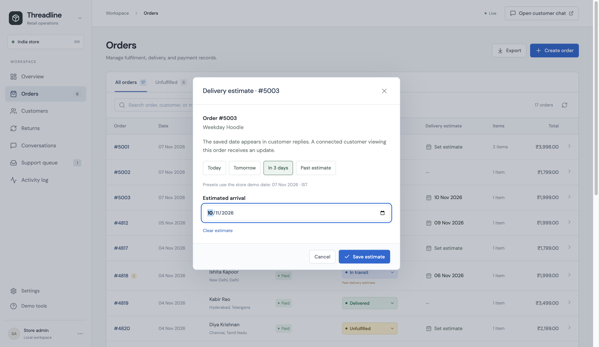
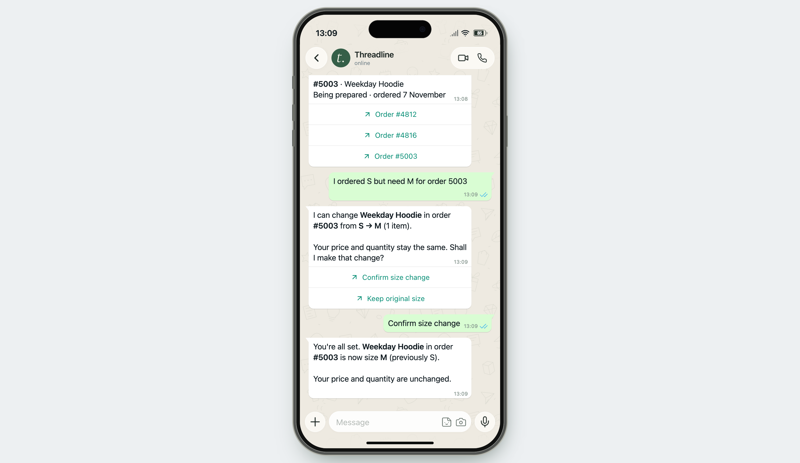

# 20 — Delivery estimates, conversation and customer order changes

**Implemented MVP v0.8 · 9 November 2026.** Read this with the [Gemini/RAG architecture](19-gemini-hybrid-live-data.md), [synchronization](14-data-and-synchronization.md) and [evidence register](17-evidence-and-faq.md). All purchases and actions are synthetic. These features use the existing application and database; they are not new courier or commerce integrations.

## What the customer can accomplish

- Ask for the current delivery estimate, tracking, order contents, payment or return progress in ordinary language.
- Explain an urgent occasion, get an acknowledgement and the actual estimate, and accept an offered store investigation with “yes please.” Only acceptance creates the support ticket.
- Request a different size for an owned, unfulfilled order, review the exact item and S → M change, and confirm it. The saved item and open dashboard update together.
- Prepare a return with reason, condition, tags, optional photos, quantity, pickup address and preferred window. Submission and staff decisions remain separate stages.

The model interprets and phrases. The application reads, checks, previews, saves and reports the result. Fine-tuning is outside scope.

## Delivery estimate experience

**Staff:** Orders now has a **Delivery estimate** column. Click the date or **Set estimate**, choose a date and save. The existing order drawer also retains its date field. Today / Tomorrow / In 3 days / Past estimate are rehearsal shortcuts using the displayed **store demo date**, not the laptop date. The seed clock is 7 November 2026 in IST. Clearing a date saves `null`; the service does not silently replace it with a calculated promise. Terminal delivered/cancelled/returned orders have no active estimate editor.

**Customer:** an ETA-only change sends a short “Delivery estimate updated” message to an eligible connected conversation selecting that order. A later question independently reads the current database. A current date is explicitly an estimate; a passed date is identified as the last estimate, with no invented replacement. Missing date means unknown. A delivered order uses its recorded delivery date. No courier location, route prediction or delivery guarantee is generated.

`PATCH /api/studio/orders/{id}` already handles the date, source timestamp and revision. The editor supplies the expected revision, rejects a conflicting save and asks the operator to reload changed details. [delivery.py](../backend/delivery.py) provides shared customer wording so notifications and replies use the same semantics. Pushes remain scoped, in-process notifications; offline delivery and a crash between commit and broadcast are not guaranteed.



## Conversational support without generated business facts

Gemini receives the customer's concern, workflow stage, a short recent context, the last assistant question and approved retrieved passages. The prompt encourages a brief acknowledgement and one relevant next step, rather than repeated menus or stock closings. It can acknowledge “you need the hoodie for a wedding tomorrow” when the customer actually supplied that deadline. That does not authorize “it will arrive tomorrow.” Targeted promise/date/value checks still apply.

A typed `next_step=delivery_investigation` can register an offer after checked wording is accepted. A later yes/no is handled by the controller without another generation call. Acceptance persists the original concern in a support ticket; decline clears the offer. A ticket is not a person joining live chat. Return answers may receive a short checked acknowledgement before the exact next workflow question; confirmations and business outcomes use the guarded renderer.

Generated language can still be awkward or misunderstood. The validator is not a universal semantic truth checker. Rejected wording uses the approved/source renderer and records why.

## Size change: a real, narrowly scoped command

**Example:** “I ordered S but need M for order 5003.” The reference is illustrative; use the order ID created in your own workspace.

1. The controller resolves the customer's actual order reference or confirmed context and calls the owned `get_order` read. A guessed order belonging to another account is rejected.
2. Multiple items require an item choice. The requested destination comes from the customer's actual words or offered size button, never a model-only size suggestion.
3. `get_product_sizes(sku)` reads enabled options from SQLite `product_sizes`. This is the configured product range, **not stock availability or an inventory reservation**.
4. Both order and selected item must still be `processing` (shown as **Unfulfilled** in ERP). A dispatched/delivered item is not edited; the service offers store exchange review and, for a delivered item, a return path. No replacement or exchange stock is promised.
5. The preview shows the exact order, item, old → new size and affected quantity. Price and quantity stay unchanged. It records the order revision and expires after ten minutes. Merely asking or choosing M does not write.
6. **Confirm size change** or an explicit change confirmation authorizes the pending preview. Bare “yes please” is accepted only immediately after the server-rendered size preview. An unrelated question followed by “yes” cannot silently apply that preview.
7. Inside `BEGIN IMMEDIATE`, `Store.amend_order_size` rechecks ownership, source controls, expected revision, order/item state, enabled SKU size and whether a change is needed. The item size, new revision/source timestamp and activity record commit in **one transaction**. Audit failure rolls back the size. Concurrent confirmations cannot both apply the same revision.
8. Expired/stale previews display current details and require new consent. Changed fulfilment blocks the edit. Success is rendered from the committed delta on the already-authorized public order projection. The workspace receives an invalidation and reloads that same database record. The receipt does not depend on a second post-commit read succeeding.

```mermaid
sequenceDiagram
    participant C as Customer
    participant W as Guarded workflow
    participant R as LiveReads
    participant D as SQLite
    participant E as ERP browser
    C->>W: Change S to M
    W->>R: Owned order + enabled SKU sizes
    R->>D: Current records
    W-->>C: Exact S → M preview, revision N
    C->>W: Confirm size change
    W->>D: Begin; recheck ownership, health, revision, state, size
    D->>D: Save size + revision N+1 + activity atomically
    D-->>W: Commit receipt
    W-->>C: Saved size confirmation
    W-->>E: Workspace changed
    E->>D: API reload of current order
```

The command changes **size on the same SKU only**. It does not change quantity, price, payment, shipping address, fulfilment or ETA; it does not cancel, refund, reserve stock or create a replacement. A production implementation needs real account verification, approved OMS variant mapping, inventory/reservation rules and an authoritative fulfilment cutoff. This demo's `processing` check is not evidence that a physical warehouse has not begun packing.



## Rehearsing the demo

1. Open ERP **Demo tools → Prepare a size-change demo**. This opens a normal order form prefilled for Aarav, size S. Review and click **Create order**; simply opening the form creates nothing.
2. Note its generated ID. In the phone use `aarav@example.com`, then “I ordered S but need M for order [ID].” Review and confirm. Keep that order drawer open in ERP to see M and the new revision arrive.
3. Open **Timeline** or **Activity log** to show the S → M activity. Ask “What did I order?” to demonstrate a new owned read.
4. Set its delivery estimate from the table. Observe the short notification, then ask “When should it arrive?” Clear the date to demonstrate that unknown remains unknown.
5. Create a fresh S order for a repeat performance, or change M back to S through the same confirmed chat flow. Order #4812 is initially in transit and deliberately demonstrates the review path, not a permitted amendment.

Do not restore samples merely to run tests; that erases subsequent demonstration records. Automated cases use isolated temporary databases.

## Code, data and evidence

| Component | Implementation |
| --- | --- |
| Intent, context, acknowledgement and offer handling | [support_plan.py](../backend/support_plan.py), [support.py](../backend/support.py), [composition.py](../backend/composition.py) |
| Size draft, item/size choice, preview and confirmation | [order_changes.py](../backend/order_changes.py) |
| Owned/healthy reads and atomic size/audit command | [reads.py](../backend/reads.py), [store.py](../backend/store.py) |
| Configured size seed and RAG guidance | [product-sizes.json](../data/product-sizes.json), [support-guides.json](../data/support-guides.json) — 26 passages, `threadline-support-v2` |
| ERP creation, size options and date editor | [erp.py](../backend/erp.py), [OperationsForms.tsx](../src/OperationsForms.tsx), [App.tsx](../src/App.tsx) |
| Source-backed notification | [whatsapp.py](../backend/whatsapp.py), [delivery.py](../backend/delivery.py) |
| Confirmation, account isolation, races, expiry and rollback | [test_order_changes.py](../backend/tests/test_order_changes.py) |
| Real-model conversations and retrieval | [v0.8 conversation results](../evaluation/results/v08-gemini-conversations.json), [v0.8 retrieval results](../evaluation/results/v08-retrieval.json) |

There is no new public “AI write” endpoint. Customer changes use the existing channel message transport and server-held draft. Catalogue entries in staff state now include enabled size options. Tests establish these defined scenarios, not general model accuracy, production security or stock guarantees.
