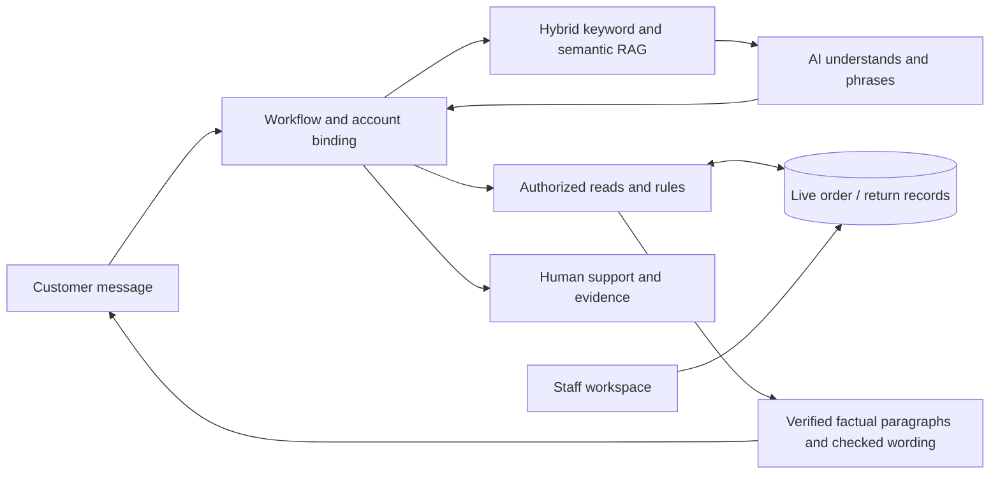

# Presentation briefing — explain the MVP clearly

**Audience:** MBA AI in Management team. **Purpose:** help the team build its own presentation now. This is a content and speaker-note pack, not a claim that the production integrations are finished.

Use the [system guide](../SYSTEM_GUIDE.md) and [documentation map](README.md). Current scope is v0.7: Gemini + hybrid RAG + live database reads. [Document 19](19-gemini-hybrid-live-data.md) gives the detailed architecture. Records are fictional; generation and embedding API calls are real. Fine-tuning is outside scope.

## The one-minute story

> Scenario A receives 400 queries per day, mainly about status and returns. Our MVP combines Gemini, hybrid retrieval and a live local order database. Semantic embeddings and keyword search find approved guidance; Gemini understands the concern and writes helpful language. Owned database reads supply exact operational facts. Backend rules control returns and staff keeps commercial responsibility. A dashboard edit changes the next answer; an outage blocks guesses. Real WhatsApp and retailer/courier/payment adapters are the next stage.

## Suggested ten-part presentation

These are content suggestions, not an instructor-supplied slide count. Each row can become one slide or a section of a slide.

| Part / slide title | Main message to put on screen | Speaker note / evidence |
| --- | --- | --- |
| 1. The operating problem | 400 queries/day; status and returns dominate; answers must use live records | These are assignment facts. Exact query mix, current response time and payroll savings are not measured. |
| 2. Our recommendation | Supervised post-purchase service over existing business systems | Automate repetitive reading and intake; staff owns exceptions and commercial decisions. |
| 3. The two experiences | Customer WhatsApp-style phone + staff operations workspace | Show [phone](../design/whatsapp-phone-only.png) and [ERP](../design/erp-dashboard.png). Current channel is a browser simulation. |
| 4. How an answer is produced | Context → retrieve guidance → understand/write → authorize/read → compile facts → record evidence | General help needs no account. The LLM writes conversational language; the application supplies current order facts. |
| 5. Why factual invention is constrained | Facts from validated reads; policy/math in code; no refund tool | Show a current order reply and its evidence. Avoid “zero hallucinations guaranteed.” |
| 6. The live proof | Change fulfilment; observe a new source-backed answer; show outage behavior | This demonstrates freshness/failure handling for synthetic records, not a real courier integration. |
| 7. A realistic return | Reason, condition, tags, photos, address, review, explicit submit; staff completes the lifecycle | Show [photo intake](../design/whatsapp-return-photo.png) and [staff evidence](../design/erp-return-evidence.png). No photo AI, pickup booking or money transfer occurs. |
| 8. Existing systems and future tools | OMS for purchases; courier for scans/pickup; gateway for refund state; helpdesk for people | These adapters are proposed. Actual retailer vendors are unknown. |
| 9. Benefits, limits and economics | Less repetitive lookup; clearer intake; traceable answers; test before scaling | Benefits are hypotheses. Measure time, case resolution, handoff load and full cost. |
| 10. Owner action and pilot gates | Confirm systems/policy → secure read-only integration → shadow review → limited pilot | End with a conditional pilot recommendation and named business/integration owners, not an unconditional rollout promise. |

## Simple architecture diagram for a slide

**How to explain it:** “The model understands the customer and writes helpful language from approved guidance. The server checks access, reads current business data and inserts the requested factual paragraphs. It validates wording or uses the source renderer. Staff writes to the operational record. Future adapters connect these same boundaries to the retailer's actual systems.”

## The live demo, with narration

Use the running app from [README](../README.md). The browser phone and dashboard should be separate tabs. Contact: `aarav@example.com` or `CUS-1001`. If rehearsals have already returned/refunded the chosen item, choose another delivered item without an active return or intentionally restore fictional samples in Settings before class. Reset clears subsequent local demo activity.

| Step | Action | Narrate |
| --- | --- | --- |
| 1 | Ask “Where is my order?”, identify Aarav and choose #4812 | “The account is matched in this demo. Production needs real account verification.” |
| 2 | Inspect the product, INR amount, status and estimate | “These fields came from the order record; the estimate is not a guarantee.” |
| 3 | Change #4812 fulfilment in the ERP table | “We changed the actual synthetic source, not the chat transcript.” |
| 4 | Observe notification, then ask “Can you check again?” | “The next lookup reads the new revision. The notification and a fresh answer are separate checks.” |
| 5 | Inspect the conversation's response evidence | “The trace shows the actual model/rules/system mode and available read evidence.” |
| 6 | Disable the order API in Settings, then ask again | “When the source is unavailable, an accurate-sounding guess is not acceptable.” Restore the source afterwards. |
| 7 | Begin a return for an eligible delivered item; answer and upload a test clothing photo | “Structured intake gathers the information a person needs. It does not automatically inspect the photo.” |
| 8 | Review/submit; open the RMA in Returns | “Only explicit submission created this record. A preferred pickup window is not a booking.” |
| 9 | Show staff approval, booking reference, receipt and inspection/refund gates | “This MVP records the workflow. It does not call a carrier or transfer money.” |

The first six steps are the core live-data proof. Use the return sequence as a second demo or screenshots if time is short. Keep a recording/screenshots as a backup for local model/server issues. Do not invent a performance result if the demo is slow.

## Ready-to-use wording for difficult claims

| Avoid saying | Say instead |
| --- | --- |
| “It is totally safe.” | “The MVP demonstrates specific safeguards on synthetic data; production identity, security and operations remain to be built and assessed.” |
| “There are no hallucinations.” | “Current values come from validated factual blocks and generated language is checked. This constrains specified errors; source, intent and qualitative wording errors remain possible.” |
| “It is connected to WhatsApp.” | “It currently simulates WhatsApp in a browser. The documented next step is an official Business Platform adapter.” |
| “The courier API is live.” | “The MVP reads a mutable local source. Courier tracking/serviceability are proposed adapters.” |
| “The customer has been authenticated.” | “The demo matched a fictional account. Production must verify access before disclosure.” |
| “The refund has reached the bank.” | “A synthetic refund was recorded after the staff gate. Gateway state and bank-credit confirmation are different.” |
| “All our tests prove AI accuracy.” | “Backend cases, authored Gemini conversations and retrieval comparisons verify defined development scenarios. They are not an unseen benchmark.” |
| “We fine-tuned the model.” | “The project implements hybrid RAG and live-data grounding. Fine-tuning is outside its scope.” |
| “We save X% or eliminate Y jobs.” | “We hypothesize less repetitive work; measure sustained resolution, time, escalation capacity and total cost first.” |
| “We replace the existing ERP.” | “The proposed service reads and coordinates existing systems. The dashboard stands in for them during this MVP.” |

## Why use AI if rules provide the facts?

Gemini's role is understanding wording/context and writing helpful guidance. Hybrid RAG retrieves approved explanations; authorized reads supply current facts; rules calculate eligibility; the state machine gathers reported answers; people decide exceptions. The rules baseline shares the same business boundary. Compare on unseen customer tasks before claiming an advantage. Provider sampling defaults and LOW thinking do not establish truth.

**What makes this more than an API wrapper:** account and order ownership, persistent operational records, hybrid ranking and versioned vector cache, current read contracts/revisions, grounded reply compilation, resumable return intake, staff gates, scoped events, failure behavior and inspectable evaluation. Show the ERP evidence panel, not only the chat bubbles.

## Questions an instructor may ask

- **What proves live data?** A saved source revision changes the next answer; an outage blocks the normal factual response. See the demo and read trace.
- **Where can it still fail?** Wrong upstream data, misinterpreted intent/item, policy bugs, identity mistakes, missed notifications and provider failures. Read [safety](11-grounding-and-safety.md).
- **What happens when courier and ERP disagree?** Preserve both sources/timestamps and escalate a conflict; do not ask the LLM to choose which one is true.
- **What happens to an offline user?** The MVP has saved state and fresh reads but no guaranteed durable order-push queue. Production needs an outbox and delivery/reconciliation workers.
- **What is missing before deployment?** Real account/staff identity, least-privilege adapters, signed webhooks, private media, secure logs/retention, durable work, evaluation and operational ownership.
- **Who owns a bad policy or wrong data?** The retailer must name the policy/source owner. Traceability helps investigate; it does not transfer responsibility to the model.

More answers, source paths and verification limits are in [evidence and FAQ](17-evidence-and-faq.md). Keep the distinction between **demonstrated**, **measured**, **assumed** and **proposed** visible throughout the presentation.
